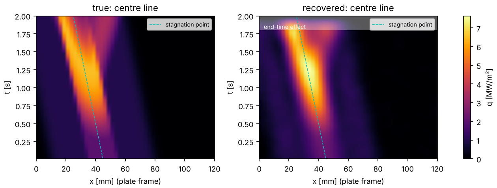

<p align="center">
  
</p>

<h1 align="center">BoilFlux</h1>

<p align="center"><b>Open inverse heat transfer for boiling and quenching</b></p>

<p align="center">
  <a href="https://github.com/boilflux/boilflux/actions/workflows/ci.yml"></a>
  <a href="https://boilflux.github.io/boilflux"></a>
  <a href="LICENSE"></a>
  
  <a href="https://doi.org/10.1016/j.applthermaleng.2026.132481"></a>
</p>

BoilFlux reconstructs the **transient, spatially resolved boiling heat flux** on the quenched face of
a hot (moving) metal plate from **infrared thermography of the opposite face**. It solves the nonlinear
3D inverse heat conduction problem with the **adjoint conjugate-gradient method**, Tikhonov
regularisation and the discrepancy principle.

<p align="center">
  
  <br><sub>Benchmark <code>M3D-AA6082</code>: AA6082 plate at 500 °C moving at 10 mm/s under a single round jet.
  Centre-line heat flux, ground truth (left) and reconstruction from noisy back-face IR data (right).</sub>
</p>

## Features

- **Nonlinear 3D conduction**: finite-volume model with temperature-dependent `k, ρ, cp` and optional
  radiation/convection loss on the IR face. `ny = 1` gives the 2D model of the reference paper.
- **Moving plates**: solved in the plate frame, with a moving stagnation point, time-dependent camera
  masks, and resampling of lab-frame IR frames onto the plate.
- **Adjoint CGM**: exact discrete adjoint and sensitivity problems (verified against finite differences),
  Polak–Ribière directions, discrepancy-principle stopping, and an end-time-effect window.
- **Boiling physics for ground truth**: Specht parabolic boiling curve with impingement and free-flow zones.
  Film, transition and nucleate boiling and the rewetting front come out of the model.
- **Boiling-regime analysis**: from the reconstruction, extracts the maximum heat flux and DNB temperature,
  the rewetting (Leidenfrost) temperature and time, regime maps (film / transition / nucleate / convection),
  and wetting-front velocities.
- **Neural operators for boiling flow** (optional `[ml]` extra): a PyTorch Fourier neural operator trained
  on interface-resolved boiling simulations (BubbleML 2.0), with autoregressive rollouts and
  wall-heat-flux evaluation. This is the forward-flow counterpart of the inverse core.
- **BF-Bench**: reproducible synthetic quench cases with known flux, generated on refined grids to avoid
  the inverse crime, with standard scores (R², RMSE, MAPE, maximum-heat-flux error).
- **Light and tested**: depends only on NumPy, SciPy, Matplotlib and PyYAML; tests with analytic
  solutions, conservation laws and gradient checks; CI on Linux, macOS and Windows.

## Install

```bash
pip install boilflux                                         # once released on PyPI
pip install git+https://github.com/boilflux/boilflux.git  # latest
```

## Quick start

```bash
boilflux demo      # synthetic moving-plate quench -> inversion -> figures in ./boilflux_demo
boilflux bench     # run all BF-Bench cases
```

```python
import boilflux as qf

data = qf.JetQuenchScenario(material="AA6082", T0=500.0, plate_velocity=0.010).generate()
result = qf.AdjointCGM(data).solve()
print(qf.flux_metrics(result.q[result.reliable], data.q_true[result.reliable]))
```

To use your own camera data, see `examples/02_experimental_ir_template.py` and the
[data guide](https://boilflux.github.io/boilflux/user-guide/data/).

## BF-Bench results (v0.1.0, adjoint CGM, σ = 2 K)

| Case | Description | R² | RMSE [MW/m²] | MAPE [%] |
|---|---|---:|---:|---:|
| `S2D-AA6082-stationary` | 2D stationary jet, AA6082, 500 °C (paper configuration) | 0.981 | 0.15 | 4.9 |
| `M3D-AA6082` | 3D, plate moving at 10 mm/s, AA6082, 500 °C | 0.970 | 0.18 | 9.7 |
| `M3D-Ni` | 3D, plate moving at 5 mm/s, nickel, 800 °C | 0.965 | 0.25 | 10.0 |
| `M3D-AA6082-window` | 3D, 20 mm/s, plate leaving the camera view | 0.974 | 0.16 | 9.6 |

Scores are computed over the frames unaffected by the end-time effect. Reproduce them with `boilflux bench`.

## Documentation

Theory, **boiling physics guide** (nucleate boiling, CHF/DNB, transition boiling, Leidenfrost, film boiling,
rewetting), CFD/OpenFOAM/PINN/neural-operator modelling, user guide, API, benchmark, related software and
roadmap: **https://boilflux.github.io/boilflux**

## Citing

Please cite the method paper and the software (see `CITATION.cff`):

> S.B. Gopalkrishna, A.K. Nallathambi, E. Specht, *Inverse heat conduction method to estimate heat flux
> during quenching of hot metals with infrared thermography measurements*, Applied Thermal Engineering
> 304 (2026) 132481. https://doi.org/10.1016/j.applthermaleng.2026.132481

## Contributing

Contributions of methods, benchmark cases and, above all, **experimental IR quench datasets** are
welcome. See [CONTRIBUTING.md](CONTRIBUTING.md).

## Licence

Code: [MIT](LICENSE). Documentation and data: CC BY 4.0.
© 2026 Suresh Babu Gopalkrishna and the BoilFlux contributors.
