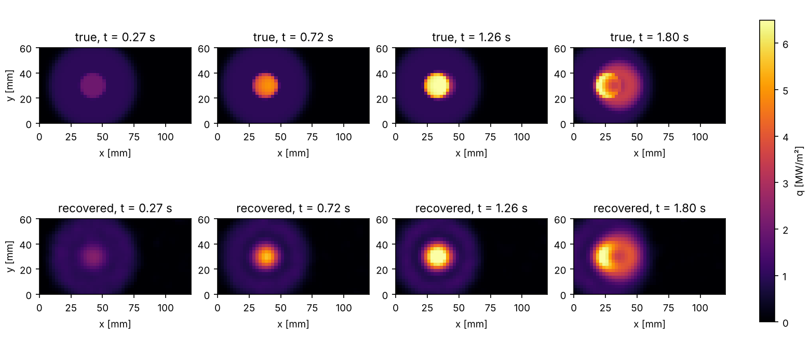
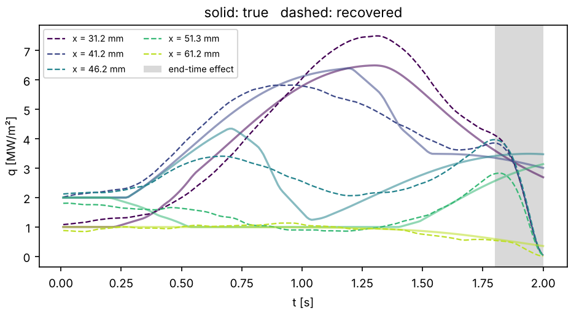
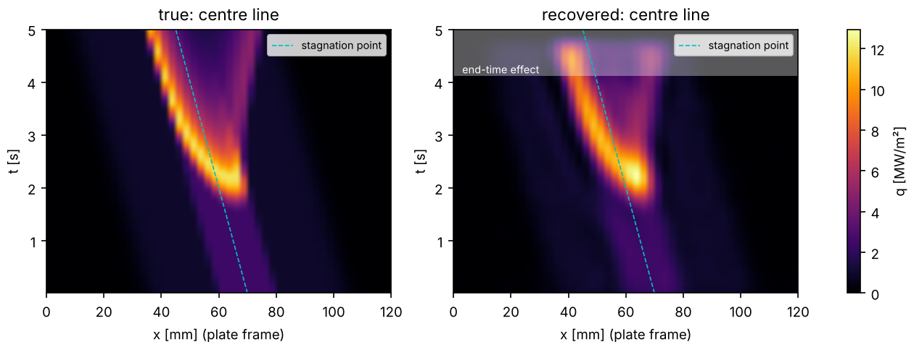

# QF-Bench

QF-Bench is a set of reproducible inverse-problem cases for boiling and quenching with known ground
truth. Any method can be scored on it against the same data.

## Tiers

| Tier | Content | Status |
|---|---|---|
| 1. Analytic | linear cases with closed-form solutions (Beck 1D, Huang–Wang 3D plate) | planned (v0.2) |
| 2. Synthetic quench twins | nonlinear 2D/3D jet quenches with a Specht boiling-curve ground truth, generated on a refined grid with controlled noise | **available** |
| 3. Cross-domain | continuous-casting mould (ROMSOC), 1D quench HTC database, IR pool boiling | planned |
| 4. Experimental IR quench | measured back-face IR on AA6082, Ni and steel plates, stationary and moving | planned (v1.0) |

## Tier-2 cases

| Case | Configuration | Grid (inversion) | Frames |
|---|---|---|---|
| `S2D-AA6082-stationary` | 2D length × thickness, stationary jet at x = 0, AA6082, \(T_0\) = 500 °C; the ATE 2026 synthetic set-up on a 100 mm plate | 80 × 1 × 6 | 300 × 10 ms |
| `M3D-AA6082` | 3D, 120 × 60 × 5 mm plate moving at 10 mm/s, round jet, AA6082, 500 °C | 48 × 24 × 5 | 200 × 10 ms |
| `M3D-Ni` | as above, pure nickel, 800 °C, 5 mm/s; slow rewetting | 48 × 24 × 5 | 500 × 10 ms |
| `M3D-AA6082-window` | 20 mm/s; the camera sees only the lab window 10–100 mm, so parts of the plate leave the view | 48 × 24 × 5 | 200 × 10 ms |

All cases use Gaussian IR noise with σ = 2 K. Data are generated on a grid refined 2× in every direction
and with half the time step, then block-averaged, so the inversion never uses its own forward model
to create data (no inverse crime).

## Scores

Scores are computed on the frames before the end-time window: R², RMSE [MW/m²], MAPE [%] over points
where \(|q| > 5\%\) of the maximum, and the relative error of the maximum heat flux (MHF).

<div class="qf-score" markdown>

| Case | Method | R² | RMSE | MAPE % | MHF % | iterations | time [s] |
|---|---|---:|---:|---:|---:|---:|---:|
| `S2D-AA6082-stationary` | adjoint CGM | 0.981 | 0.153 | 4.9 | +4.6 | 61 | 24 |
| `M3D-AA6082` | adjoint CGM | 0.970 | 0.178 | 9.7 | +17.6 | 34 | 39 |
| `M3D-Ni` | adjoint CGM | 0.965 | 0.247 | 10.0 | +8.4 | 59 | 131 |
| `M3D-AA6082-window` | adjoint CGM | 0.974 | 0.163 | 9.6 | +17.5 | 39 | 45 |

</div>

Laptop-class CPU (2 cores), QuenchFlux 0.1.0, default `CGMOptions` (τ = 1.02, γ = 0). The MHF error is a
single-point maximum, so it is sensitive to noise. The 3D cases overshoot because noise-driven
oscillations add to the sharp moving peak.

<figure class="qf-figure" markdown>

<figcaption><code>M3D-AA6082</code>: true (top) and recovered (bottom) heat flux on the quenched face at four
instants.</figcaption>
</figure>

<figure class="qf-figure" markdown>

<figcaption>Heat-flux histories at points along the jet path (solid: truth; dashed: recovered). The grey
band is the end-time window, excluded from the scores.</figcaption>
</figure>

<figure class="qf-figure" markdown>

<figcaption><code>M3D-Ni</code>: the rewetting front develops ahead of the moving jet only after about 2 s of film
boiling.</figcaption>
</figure>

## Run it yourself

```bash
quenchflux bench                       # all cases, figures in ./quenchflux_bench/<case>/
quenchflux bench --case M3D-Ni
```

## Submitting a method

Open a pull request that adds your method behind the common interface (dataset in, `q(t, y, x)` out)
together with its scores from `quenchflux bench`. Methods must not be tuned on the scored cases.
