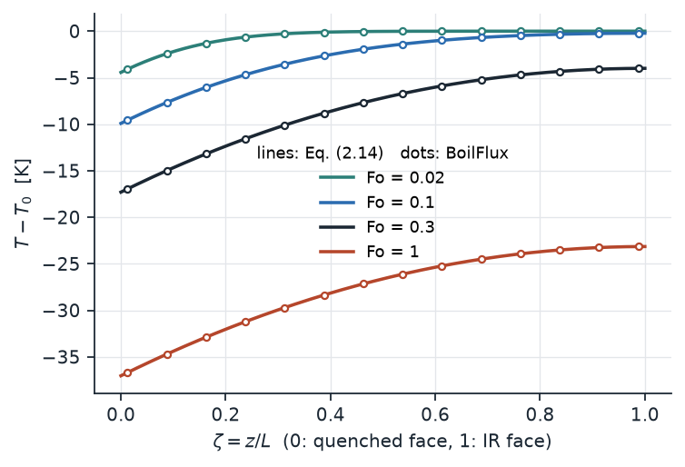
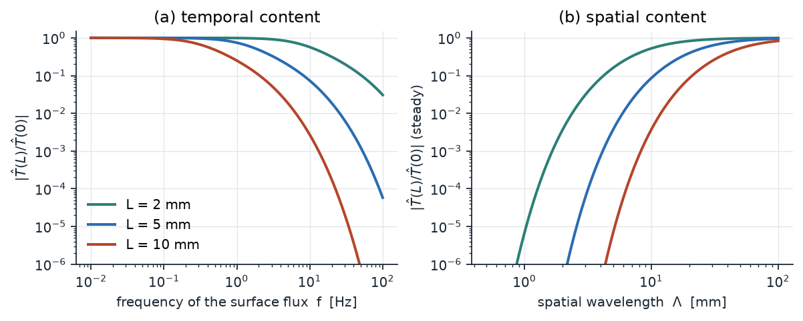

# 2. Analytical solutions and characteristic scales

Closed-form solutions of the linear heat equation do three jobs in this book. They set the
time and length scales of a quench, they verify the numerical solver, and they show quantitatively why the
inverse problem is ill-posed: the plate filters the surface flux exponentially before it reaches the
camera.

Throughout this chapter the properties are constant (\(k,\rho c_p,\alpha\)). The nonlinear problem behaves
locally like the linear one with the properties at the local temperature.

## 2.1 Dimensionless form

Let \(L\) be the plate thickness, \(q_0\) a flux scale and \(T_0\) the initial temperature. Introduce

\[
\zeta = \frac zL,\qquad \mathrm{Fo} = \frac{\alpha t}{L^2},\qquad
\vartheta = \frac{k\,(T-T_0)}{q_0 L},\qquad
\mathrm{Bi} = \frac{hL}{k},\qquad \mathrm{Pe} = \frac{vL}{\alpha}.
\tag{2.1}
\]

The **Fourier number** Fo is time measured in units of the through-thickness diffusion time
\(t_d = L^2/\alpha\). The **Biot number** compares the conductance of a surface heat-transfer coefficient
\(h\) with that of the plate. The **Péclet number** compares transport by plate motion with diffusion. In these
variables the one-dimensional heat equation and the flux condition of (1.12) read

\[
\frac{\partial\vartheta}{\partial\mathrm{Fo}} = \frac{\partial^2\vartheta}{\partial\zeta^2},
\qquad \left.\frac{\partial\vartheta}{\partial\zeta}\right|_{\zeta=0} = \frac{q}{q_0}.
\tag{2.2}
\]

| Quantity | AA6082, \(L=5\) mm | Nickel at 800 °C, \(L=5\) mm |
|---|---|---|
| diffusivity \(\alpha\) | \(7.2\times10^{-5}\) m²/s | \(1.4\times10^{-5}\) m²/s |
| diffusion time \(t_d=L^2/\alpha\) | 0.35 s | 1.8 s |
| Biot number of the jet, \(h\approx q_\text{max}/\Delta T\approx 3.6\times10^4\) W/(m² K) | 1.0 | 3 |
| Péclet number, \(v=10\) mm/s, based on \(L\) | 0.7 | 3.6 |

A Biot number of order one means that the temperature drop across the thickness is comparable with the
drop between the surface and the water. The plate cannot be treated as isothermal through its thickness,
which is why BoilFlux solves a 3D (or 2D) conduction problem instead of a lumped one.

## 2.2 Lumped capacitance

If \(\mathrm{Bi}\ll1\) the plate is nearly isothermal, and integrating the energy balance (1.2) over the whole
body gives an ordinary differential equation for its mean temperature:

\[
\rho c_p V\,\frac{\mathrm dT}{\mathrm dt} = -hA\,(T - T_\infty)
\quad\Longrightarrow\quad
T - T_\infty = (T_0 - T_\infty)\,e^{-t/\tau},\qquad \tau = \frac{\rho c_p V}{hA}.
\tag{2.3}
\]

Why \(\mathrm{Bi}\) is the criterion: a flux \(q\) causes an internal temperature difference of order \(qL/k\) and an
external one of order \(q/h\). Their ratio is \(hL/k=\mathrm{Bi}\). The usual rule \(\mathrm{Bi}<0.1\) keeps the
internal difference below 10 % of the external one. Quenching with \(\mathrm{Bi}\approx1\)–3 violates it.

## 2.3 The semi-infinite solid

At early times, \(t\ll t_d\), heat has not yet reached the far face and the plate behaves as a half-space
\(z>0\). Let \(\theta=(T-T_0)/(T_s-T_0)\) after the surface is suddenly brought to \(T_s\). There is no length scale
in the problem other than \(\sqrt{\alpha t}\), so we look for a solution of the **similarity variable**

\[
\eta = \frac{z}{2\sqrt{\alpha t}} .
\]

With \(\partial_t\theta = -\eta\,\theta'(\eta)/(2t)\) and \(\partial_{zz}\theta = \theta''(\eta)/(4\alpha t)\), the heat
equation becomes an ordinary differential equation,

\[
\theta'' + 2\eta\,\theta' = 0 .
\tag{2.4}
\]

Its solution with \(\theta(0)=1\) and \(\theta(\infty)=0\) is \(\theta = \operatorname{erfc}\eta\), with
\(\operatorname{erf}\eta = (2/\sqrt\pi)\int_0^\eta e^{-s^2}\mathrm ds\) and \(\operatorname{erfc}=1-\operatorname{erf}\):

\[
T(z,t) = T_s + (T_0 - T_s)\,\operatorname{erf}\!\frac{z}{2\sqrt{\alpha t}} .
\tag{2.5}
\]

The heat flux extracted at the surface follows from \(q = k\,\partial_z T|_{z=0}\):

\[
q(t) = \frac{k\,(T_0-T_s)}{\sqrt{\pi\alpha t}} = \frac{e\,(T_0 - T_s)}{\sqrt{\pi t}},
\qquad e = \sqrt{k\rho c_p}.
\tag{2.6}
\]

The **thermal effusivity** \(e\) [J/(m² K s\(^{1/2}\))] measures how readily a body gives up heat through its
surface.

### Constant extracted flux

If instead a constant flux \(q\) is extracted from \(t=0\), differentiate the heat equation with respect to \(z\):
the field \(F = k\,\partial_z T\) also satisfies the heat equation, with \(F(0,t)=q\) and \(F(z,0)=0\). By (2.5) applied
to \(F\), \(F = q\operatorname{erfc}\eta\). Integrating \(\partial_z T = F/k\) from \(z\) to \(\infty\), with
\(T\to T_0\) at infinity and \(\int_\eta^\infty\operatorname{erfc}s\,\mathrm ds = e^{-\eta^2}/\sqrt\pi - \eta\operatorname{erfc}\eta\),

\[
T(z,t) = T_0 - \frac{2q}{k}\sqrt{\frac{\alpha t}{\pi}}\;e^{-z^2/(4\alpha t)} + \frac{q\,z}{k}\operatorname{erfc}\frac{z}{2\sqrt{\alpha t}} ,
\tag{2.7}
\]

and in particular the surface temperature falls as the square root of time:

\[
T_s(t) = T_0 - \frac{2q}{e}\sqrt{\frac{t}{\pi}} .
\tag{2.8}
\]

### Contact temperature of two bodies

When cold liquid at \(T_l\) touches a wall at \(T_w\), both behave as half-spaces with a common interface
temperature \(T_i\). Each side obeys (2.5) with constant surface temperature \(T_i\), so by (2.6) the flux leaving
the wall and the flux entering the liquid are \(e_w(T_w-T_i)/\sqrt{\pi t}\) and \(e_l(T_i-T_l)/\sqrt{\pi t}\).
Equating them, the factor \(\sqrt{\pi t}\) cancels and \(T_i\) is constant in time:

\[
T_i = \frac{e_w T_w + e_l T_l}{e_w + e_l} .
\tag{2.9}
\]

For aluminium (\(e_w\approx 2.1\times10^4\)) against water (\(e_l\approx 1.6\times10^3\)), \(T_w-T_i\) is only 7 % of
\(T_w-T_l\): the wall surface hardly cools on contact. This result is central to the Leidenfrost physics of [Chapter 4](04-boiling-curve.md).

## 2.4 The finite slab with a constant extracted flux

Now take the full thickness: flux \(q\) extracted at \(\zeta=0\), insulated at \(\zeta=1\), uniform initial
temperature. In the variables (2.1) with \(q_0=q\):

\[
\partial_{\mathrm{Fo}}\vartheta = \partial_{\zeta\zeta}\vartheta,\qquad
\partial_\zeta\vartheta(0,\mathrm{Fo}) = 1,\qquad
\partial_\zeta\vartheta(1,\mathrm{Fo}) = 0,\qquad
\vartheta(\zeta,0)=0 .
\tag{2.10}
\]

**Step 1: the quasi-steady part.** Energy leaves at a constant rate, so after a transient the whole slab cools
at a uniform rate. Try \(\vartheta_\infty = -\mathrm{Fo} + \psi(\zeta)\). Substituting gives \(\psi''=-1\), and the boundary
conditions give \(\psi'(0)=1\), \(\psi'(1)=0\), hence \(\psi = \zeta - \zeta^2/2 + c\). Choose \(c\) so that \(\psi\) has zero
mean, \(\int_0^1\psi\,\mathrm d\zeta = 0\), which puts all the energy loss into the \(-\mathrm{Fo}\) term:

\[
\psi(\zeta) = \zeta - \frac{\zeta^2}{2} - \frac13 .
\tag{2.11}
\]

**Step 2: the transient.** The remainder \(\vartheta-\vartheta_\infty\) solves the heat equation with homogeneous
Neumann conditions, so it is a cosine series \(\sum_n a_n\cos(n\pi\zeta)\,e^{-n^2\pi^2\mathrm{Fo}}\) (the \(n=0\) term
vanishes because \(\psi\) has zero mean). The initial condition requires \(\sum_n a_n\cos(n\pi\zeta) = -\psi(\zeta)\), so

\[
a_n = -2\int_0^1\psi(\zeta)\cos(n\pi\zeta)\,\mathrm d\zeta .
\tag{2.12}
\]

With \(\int_0^1\zeta\cos(n\pi\zeta)\,\mathrm d\zeta = ((-1)^n-1)/(n\pi)^2\) and
\(\int_0^1\zeta^2\cos(n\pi\zeta)\,\mathrm d\zeta = 2(-1)^n/(n\pi)^2\), the integral of \(\zeta-\zeta^2/2\) is
\(-1/(n\pi)^2\); the constant contributes nothing. Hence

\[
a_n = \frac{2}{n^2\pi^2} .
\tag{2.13}
\]

!!! theorem "Result 2.1 (slab with constant extracted flux)"
    \[
    \frac{k\,(T-T_0)}{qL} = -\mathrm{Fo} + \zeta - \frac{\zeta^2}{2} - \frac13
    + \sum_{n=1}^{\infty}\frac{2}{n^2\pi^2}\cos(n\pi\zeta)\,e^{-n^2\pi^2\mathrm{Fo}} .
    \tag{2.14}
    \]

At the observed face \(\zeta = 1\) the series term is \(\sum 2(-1)^n e^{-n^2\pi^2\mathrm{Fo}}/(n\pi)^2\):

\[
\frac{k\,(T(L,t)-T_0)}{qL} = -\mathrm{Fo} + \frac16 + \sum_{n=1}^\infty\frac{2(-1)^n}{n^2\pi^2}\,e^{-n^2\pi^2\mathrm{Fo}} .
\tag{2.15}
\]

At \(\mathrm{Fo}=0\) the sum equals \(-1/6\) and the back face has not moved. At \(\mathrm{Fo}=0.05\) it has moved by
0.02 % of \(qL/k\); it begins to respond noticeably only around \(\mathrm{Fo}\approx0.1\) (0.8 %), that is after
about \(0.1\,t_d\approx 35\) ms for 5 mm of aluminium. Every term of
the series decays like \(e^{-n^2\pi^2\mathrm{Fo}}\): fine detail of the response is lost first.

<figure class="bf-figure" markdown>

<figcaption><b>Figure 2.1.</b> Temperature through a 5 mm AA6082 slab with 1 MW/m² extracted at
\(\zeta=0\). Lines: Eq. (2.14). Dots: the BoilFlux finite-volume solver with 40 cells. The largest difference is
0.014 K on a scale of 27.8 K.</figcaption>
</figure>

## 2.5 Duhamel's theorem: the linear forward map

Let \(\phi(z,t)\) be the temperature change caused by a **unit step** of extracted flux applied at \(t=0\), for
example Eq. (2.15) with \(q=1\). Because the problem is linear and time-invariant, a flux history \(q(\tau)\) can be
written as a superposition of steps \(\mathrm dq(\tau)\) starting at times \(\tau\):

\[
T(z,t) - T_0 = \int_0^t \phi(z,t-\tau)\,\mathrm dq(\tau)
= \int_0^t q(\tau)\,\frac{\partial\phi}{\partial t}(z,t-\tau)\,\mathrm d\tau ,
\tag{2.16}
\]

where the second form follows by integration by parts with \(\phi(z,0)=0\). At the measured face this is a
**Volterra integral equation of the first kind** for the unknown \(q\):

\[
Y(t) = T_0 + \int_0^t K(t-\tau)\,q(\tau)\,\mathrm d\tau,\qquad K(t) = \partial_t\phi(L,t).
\tag{2.17}
\]

The kernel \(K\) is the response to a flux impulse. Two features matter for Part IV. It is zero for small \(t\) to
all orders: by (2.15) the response becomes noticeable only after a delay of about \(0.1\,t_d\). And it is smooth, so the
integral averages \(q\) over a window of width about \(t_d\). Discretised in time, (2.17) becomes the lower-triangular
matrix equation \(\mathbf y = \mathbf X\mathbf q\) whose singular values are examined in
[Chapter 8](08-ill-posedness.md).

## 2.6 Frequency response: how the plate filters the surface flux

Duhamel's theorem shows that the plate averages. A frequency analysis shows **how strongly**. Consider a
surface flux with one spatial wavenumber \(\boldsymbol\kappa=(\kappa_x,\kappa_y)\) and one angular frequency \(\omega\),
on a plate of thickness \(L\) insulated at \(z=L\):

\[
q = \hat q\,e^{\mathrm i(\kappa_x x + \kappa_y y + \omega t)},\qquad
T - \bar T = \hat\theta(z)\,e^{\mathrm i(\kappa_x x + \kappa_y y + \omega t)} .
\]

Substitution into \(\partial_t T = \alpha\Delta T\) gives \(\mathrm i\omega\hat\theta = \alpha(\hat\theta'' - \kappa^2\hat\theta)\), that is

\[
\hat\theta'' = \lambda^2\hat\theta,\qquad
\lambda = \sqrt{\kappa^2 + \mathrm i\,\omega/\alpha}\quad(\operatorname{Re}\lambda>0),
\tag{2.18}
\]

with \(\kappa=\lvert\boldsymbol\kappa\rvert\). The solution with \(\hat\theta'(L)=0\) is \(\hat\theta = A\cosh\lambda(L-z)\). The flux condition
\(k\hat\theta'(0) = \hat q\) gives \(A = -\hat q/(k\lambda\sinh\lambda L)\). Therefore

\[
\hat\theta(L) = -\frac{\hat q}{k\lambda\sinh(\lambda L)},\qquad
\hat\theta(0) = -\frac{\hat q\,\coth(\lambda L)}{k\lambda},\qquad
\frac{\hat\theta(L)}{\hat\theta(0)} = \frac{1}{\cosh(\lambda L)} .
\tag{2.19}
\]

!!! theorem "Result 2.2 (exponential attenuation)"
    For \(\lvert\lambda L\rvert\gg1\), \(\lvert\hat\theta(L)/\hat\theta(0)\rvert \approx 2\,e^{-L\operatorname{Re}\lambda}\), with

    \[
    \operatorname{Re}\lambda = \sqrt{\frac{\omega}{2\alpha}}\ \ \text{(uniform flux, }\kappa=0\text{)},\qquad
    \operatorname{Re}\lambda = \kappa = \frac{2\pi}{\Lambda}\ \ \text{(steady pattern of wavelength }\Lambda\text{)}.
    \tag{2.20}
    \]

    Temporal content above the frequency \(\omega\sim\alpha/L^2\) and spatial detail finer than \(\Lambda\sim L\) reach the
    observed face attenuated exponentially.

<figure class="bf-figure" markdown>

<figcaption><b>Figure 2.2.</b> Ratio of the back-face to the front-face temperature amplitude, Eq. (2.19), for
AA6082 plates of 2, 5 and 10 mm. (a) Uniform flux oscillating at frequency \(f\). (b) Steady spatial pattern of
wavelength \(\Lambda\).</figcaption>
</figure>

Numbers for 5 mm of AA6082: a 10 Hz flux oscillation arrives with 7 % of its front-face amplitude; a steady
pattern of 5 mm wavelength with 0.4 %; one of 2 mm wavelength with \(3\times10^{-7}\). An IR camera with 0.5 K noise
cannot see the last one at all, whatever the algorithm. This is the physical resolution limit quoted in the
[theory overview](../theory/index.md), and the reason why the inverse problem must be regularised.

## Exercises

!!! exercise "2.1"
    Show from (2.15) that for large Fo the back face lags the front face by \(qL/(2k)\) and that both cool at the
    rate \(q/(\rho c_p L)\). Interpret the lag with Fourier's law.

!!! exercise "2.2"
    Use (2.9) to compute the contact temperature of 20 °C water on nickel at 800 °C
    (\(e_\text{Ni}\approx 1.8\times10^4\) J/(m² K s\(^{1/2}\))). *Answer:* about 740 °C.

!!! exercise "2.3"
    A camera records at 100 Hz with noise \(\sigma=0.5\) K. A periodic flux component of amplitude \(\hat q\) and
    frequency \(f\) is detectable only if its back-face amplitude exceeds \(\sigma\). Using (2.19), find the largest
    detectable \(f\) for \(\hat q = 1\) MW/m² on 5 mm of AA6082.
