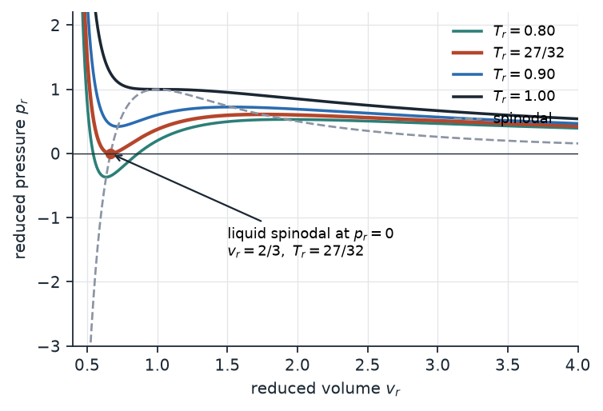

# 3. Thermodynamics of phase change and nucleation

Boiling begins with a vapour nucleus that must survive surface tension, and the
Leidenfrost point is bounded by the temperature at which liquid can no longer exist. Both follow from
equilibrium thermodynamics. This chapter derives the Clausius–Clapeyron and Young–Laplace relations, the
superheat needed for nucleation, Hsu's criterion, and the superheat limit of a liquid.

Temperatures in this chapter are **absolute** (kelvin) unless stated otherwise. Property values for water at
1 atm are collected in [Appendix A](appendix-a-notation.md#water-at-1-atm).

## 3.1 Phase equilibrium and the Clausius–Clapeyron relation

Two phases of a pure substance coexist at temperature \(T\) and pressure \(p\) only if their specific Gibbs energies
are equal, \(g_l(T,p) = g_v(T,p)\). This defines the **saturation curve** \(p_\text{sat}(T)\), or its inverse
\(T_\text{sat}(p)\). Moving along the curve, both Gibbs energies change by the same amount. With the Gibbs relation
\(\mathrm dg = -s\,\mathrm dT + v\,\mathrm dp\) for each phase,

\[
-s_l\,\mathrm dT + v_l\,\mathrm dp = -s_v\,\mathrm dT + v_v\,\mathrm dp
\quad\Longrightarrow\quad
\frac{\mathrm dp_\text{sat}}{\mathrm dT} = \frac{s_v - s_l}{v_v - v_l} .
\]

At constant \(T\) and \(p\) the latent heat is \(h_{fg} = T(s_v - s_l)\). Hence

!!! theorem "Result 3.1 (Clausius–Clapeyron)"
    \[
    \frac{\mathrm dp_\text{sat}}{\mathrm dT} = \frac{h_{fg}}{T\,(v_v - v_l)}
    \approx \frac{\rho_v\,h_{fg}}{T}
    \qquad (v_v = 1/\rho_v \gg v_l).
    \tag{3.1}
    \]

    With the ideal-gas law \(\rho_v = p/(R_g T)\) and constant \(h_{fg}\), integration gives
    \(\ln(p_2/p_1) = (h_{fg}/R_g)(1/T_1 - 1/T_2)\).

For water at 1 atm, \(\mathrm dp_\text{sat}/\mathrm dT \approx 0.597\times2.257\times10^6/373 \approx 3.6\) kPa/K.

## 3.2 Surface tension and the Young–Laplace equation

A curved interface with surface tension \(\sigma\) [N/m] supports a pressure jump. For a spherical bubble of
radius \(r\), consider a virtual growth \(\mathrm dr\) at fixed pressures. The work done by the pressure difference
equals the increase of surface energy:

\[
(p_v - p_l)\,4\pi r^2\,\mathrm dr = \sigma\,8\pi r\,\mathrm dr
\quad\Longrightarrow\quad
p_v - p_l = \frac{2\sigma}{r} .
\tag{3.2}
\]

For a general interface with principal radii \(R_1, R_2\) the jump is \(\sigma(1/R_1 + 1/R_2)\). Two length scales of
boiling follow from comparing surface tension with gravity and with inertia. The **capillary length**

\[
L_c = \sqrt{\frac{\sigma}{g\,(\rho_l - \rho_v)}}
\tag{3.3}
\]

is 2.5 mm for water at 1 atm. It sets bubble departure sizes and the Rayleigh–Taylor wavelengths of
[Chapter 4](04-boiling-curve.md).

## 3.3 How much superheat does a bubble need?

A vapour bubble of radius \(r\) in liquid at pressure \(p_l\) contains vapour at \(p_v = p_l + 2\sigma/r\). The vapour is
in equilibrium with the surrounding liquid only if the liquid is at the saturation temperature of the
**vapour** pressure, which is higher than \(T_\text{sat}(p_l)\). The required liquid superheat follows from (3.1):

\[
\Delta T_\text{sat} = T_\text{sat}\!\left(p_l + \tfrac{2\sigma}{r}\right) - T_\text{sat}(p_l)
\approx \frac{\mathrm dT_\text{sat}}{\mathrm dp}\,\frac{2\sigma}{r}
= \frac{2\sigma\,T_\text{sat}}{\rho_v\,h_{fg}\,r} .
\tag{3.4}
\]

The linearisation is accurate when \(2\sigma/r\ll p_l\). In water at 1 atm, \(2\sigma/r = 0.12\) bar for
\(r = 10\ \mu\)m but 1.2 bar for \(r = 1\ \mu\)m; for nuclei of a micrometre or less, use the integrated form of
(3.1) instead.

!!! theorem "Result 3.2 (critical radius)"
    In liquid with superheat \(\Delta T_\text{sat}\), a vapour nucleus of radius

    \[
    r^* = \frac{2\sigma\,T_\text{sat}}{\rho_v\,h_{fg}\,\Delta T_\text{sat}}
    \tag{3.5}
    \]

    is in equilibrium. The equilibrium is **unstable**: a larger nucleus needs less superheat than the liquid
    provides, evaporates and grows; a smaller one condenses and collapses.

For water at 1 atm, \(2\sigma T_\text{sat}/(\rho_v h_{fg}) = 3.3\times10^{-5}\) K m, so \(r^* = 3.3\ \mu\)m at 10 K superheat.
Bubbles in a pure liquid would therefore need enormous superheats to form from nothing (Section 3.5). On real
surfaces they grow from gas or vapour trapped in **cavities** with mouth radii of micrometres, and (3.4) with
\(r = r_c\) gives the superheat at which such a cavity becomes active.

## 3.4 Which cavities are active: Hsu's criterion

A cavity can only nucleate if the liquid around the bubble cap is hot enough. Near the wall, liquid flowing
over a heated surface has a thermal boundary layer of thickness \(\delta_t\). Approximate its profile as linear,
from the wall temperature \(T_w\) to the bulk liquid temperature \(T_\infty\):

\[
T(y) = T_w - (T_w - T_\infty)\,\frac{y}{\delta_t},\qquad 0\le y\le\delta_t .
\tag{3.6}
\]

Let the bubble cap of a nucleus growing from a cavity of radius \(r_c\) sit at height \(y_b = a\,r_c\), with radius of
curvature \(r_b = b\,r_c\). The constants \(a, b\) of order 1–2 depend on the contact angle. The cavity is active if
the liquid at the cap exceeds the equilibrium temperature (3.4):

\[
T_w - (T_w-T_\infty)\,\frac{a\,r_c}{\delta_t} \ \ge\ T_\text{sat} + \frac{B}{b\,r_c},
\qquad B = \frac{2\sigma T_\text{sat}}{\rho_v h_{fg}} .
\tag{3.7}
\]

Multiplying by \(r_c>0\) gives a quadratic inequality. With \(\Delta T_w = T_w - T_\text{sat}\) and
\(\Delta T_\text{tot} = T_w - T_\infty\),

\[
\frac{a\,\Delta T_\text{tot}}{\delta_t}\,r_c^2 - \Delta T_w\,r_c + \frac{B}{b} \le 0 ,
\tag{3.8}
\]

!!! theorem "Result 3.3 (Hsu's criterion)"
    Cavities are active in the band \(r_{c,\min}\le r_c\le r_{c,\max}\),

    \[
    r_{c,\min/\max} = \frac{\delta_t}{2a\,\Delta T_\text{tot}}
    \left[\Delta T_w \mp \sqrt{\Delta T_w^2 - \frac{4aB\,\Delta T_\text{tot}}{b\,\delta_t}}\,\right],
    \tag{3.9}
    \]

    which exists only if the wall superheat exceeds the **onset of nucleate boiling** (ONB) value

    \[
    \Delta T_{w,\text{ONB}} = 2\sqrt{\frac{aB\,\Delta T_\text{tot}}{b\,\delta_t}} .
    \tag{3.10}
    \]

Two consequences matter for jet quenching. A thinner boundary layer (fast flow at the stagnation point) and
stronger subcooling (larger \(\Delta T_\text{tot}\)) both **raise** the ONB superheat, so incipience is delayed under a
subcooled jet. And the active band widens as the superheat rises, which is one reason why the nucleate-boiling
flux grows so steeply with superheat ([Chapter 4](04-boiling-curve.md)).

## 3.5 Homogeneous nucleation and the superheat limit

Without cavities, vapour must form spontaneously by density fluctuations in the bulk liquid. Two descriptions
give the upper bound of the liquid temperature.

### Thermodynamic limit: the spinodal

A cubic equation of state predicts a metastable superheated liquid branch that ends where the liquid becomes
mechanically unstable, \((\partial p/\partial v)_T = 0\): the **spinodal**. In reduced variables
\(p_r = p/p_c\), \(v_r = v/v_c\), \(T_r = T/T_c\), the van der Waals equation is

\[
p_r = \frac{8T_r}{3v_r - 1} - \frac{3}{v_r^2} .
\tag{3.11}
\]

Setting \(\partial p_r/\partial v_r = 0\) gives the spinodal,

\[
-\frac{24\,T_r}{(3v_r-1)^2} + \frac{6}{v_r^3} = 0
\quad\Longrightarrow\quad
T_r = \frac{(3v_r - 1)^2}{4v_r^3} .
\tag{3.12}
\]

At atmospheric pressure \(p_r = p/p_c \approx 0.005\approx0\). Setting \(p_r = 0\) in (3.11) gives
\(T_r = 3(3v_r-1)/(8v_r^2)\). Equating with (3.12):

\[
\frac{3v_r - 1}{4v_r} = \frac38
\quad\Longrightarrow\quad v_r = \frac23,\qquad T_r = \frac{27}{32} .
\tag{3.13}
\]

!!! theorem "Result 3.4 (van der Waals superheat limit)"
    At pressures small compared with the critical pressure, a van der Waals liquid cannot be superheated
    beyond \(T \approx \tfrac{27}{32}\,T_c\) (absolute temperature). For water, \(T_c = 647.1\) K gives 546 K, that is
    **273 °C**.

<figure class="bf-figure" markdown>

<figcaption><b>Figure 3.1.</b> Reduced van der Waals isotherms and the spinodal (dashed). The
\(T_r = 27/32\) isotherm touches \(p_r = 0\) exactly at the liquid spinodal, \(v_r = 2/3\).</figcaption>
</figure>

### Kinetic limit: classical nucleation theory

The free-energy cost of forming a spherical vapour embryo of radius \(r\) in liquid is the surface energy minus
the volume work gained:

\[
\Delta G(r) = 4\pi r^2\sigma - \frac43\pi r^3\,(p_v - p_l) .
\tag{3.14}
\]

It has a maximum at \(\mathrm d\Delta G/\mathrm dr = 0\), which is the critical radius \(r^* = 2\sigma/(p_v-p_l)\) of (3.2), with

\[
\Delta G^* = \frac{16\pi\,\sigma^3}{3\,(p_v - p_l)^2} .
\tag{3.15}
\]

Embryos form at the rate \(J = J_0\exp(-\Delta G^*/k_B T)\) per unit volume and time, with a kinetic prefactor
\(J_0\sim10^{39}\) m⁻³ s⁻¹. Because \(\Delta G^*\) falls steeply as the superheat raises \(p_v-p_l\), \(J\) switches from
negligible to explosive over a few kelvin. For water at 1 atm this happens at about 300–320 °C (about
\(0.89\,T_c\)), somewhat above the van der Waals estimate. Both estimates bound the temperature at which liquid
can remain in contact with a hot wall.

## 3.6 From nucleation to the Leidenfrost point

When liquid touches a wall, the interface takes the contact temperature \(T_i\) of Eq. (2.9). If \(T_i\) exceeds
the superheat limit, the liquid in contact flashes to vapour before it can wet the surface, and a vapour film
forms. Rewetting therefore requires

\[
T_i = \frac{e_w T_w + e_l T_l}{e_w + e_l} \ \lesssim\ T_\text{lim} \approx 300\text{–}320\ ^\circ\text{C (water, 1 atm)} .
\tag{3.16}
\]

For metals \(e_w\gg e_l\), so \(T_i\approx T_w\) and the bound applies almost to the wall temperature itself. Measured
quench rewetting temperatures (350–650 °C) lie well above it. [Chapter 4](04-boiling-curve.md) explains the
mechanisms that raise the apparent Leidenfrost point under jets.

## Exercises

!!! exercise "3.1"
    Integrate (3.1) from 1 atm and 100 °C, with \(h_{fg}\) constant and the ideal-gas law, to estimate the
    saturation temperature at 2 bar. Compare with steam tables (120.2 °C).

!!! exercise "3.2"
    For \(a=2\), \(b=1\), saturated water (\(\Delta T_\text{tot} = \Delta T_w\)) and \(\delta_t = 50\ \mu\)m, evaluate (3.10).
    How does the result change for 80 K subcooling?

!!! exercise "3.3"
    Show that (3.15) can be written \(\Delta G^* = \tfrac13\,\sigma\,A^*\), one third of the surface energy of the
    critical nucleus.
