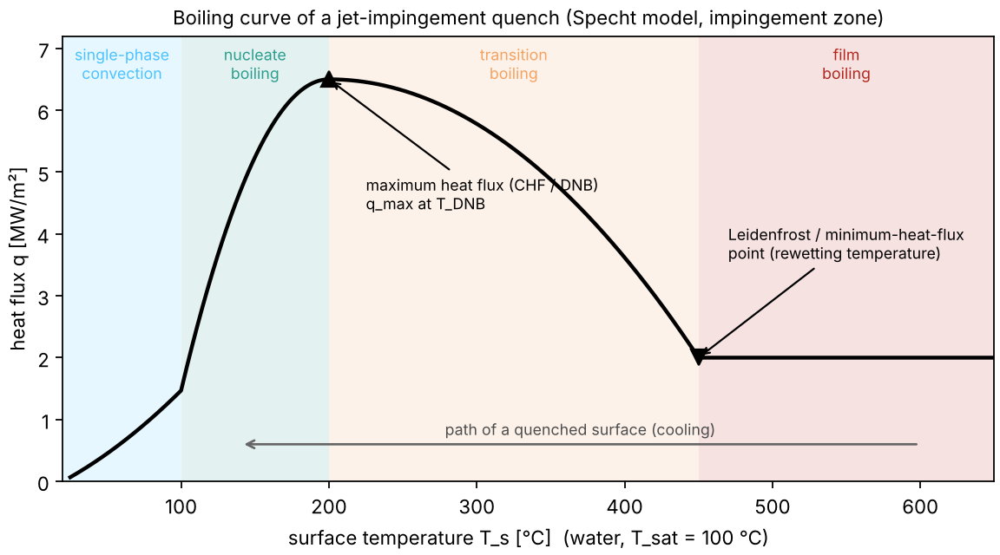

# 4. The boiling curve

The boiling curve \(q(\Delta T_\text{sat})\) is the boundary condition of a quench. This chapter
derives its landmarks from hydrodynamic instability and film-flow analysis: the critical heat flux from the
Rayleigh–Taylor and Helmholtz instabilities, film boiling from a Nusselt-type analysis, the minimum heat flux,
and the instability of transition boiling. It ends with the parabolic boiling curve that BoilFlux uses as
ground truth.

## 4.1 Regimes

Nukiyama (1934) heated a wire electrically in water and controlled the **power**. As the power increased, the
wall superheat \(\Delta T_\text{sat} = T_w - T_\text{sat}\) rose slowly through nucleate boiling, then jumped by hundreds of
kelvin when a maximum flux was exceeded. Experiments that control the wall **temperature** instead reveal the
full curve:

<figure class="bf-figure" markdown>

<figcaption><b>Figure 4.1.</b> The boiling curve used as ground truth in BoilFlux (impingement-zone parameters,
Section 4.7), with its regimes and characteristic points.</figcaption>
</figure>

| Regime | Superheat range | Mechanism | Slope \(\mathrm dq/\mathrm dT_w\) |
|---|---|---|---|
| single-phase convection | \(T_w < T_\text{sat} + \Delta T_\text{ONB}\) | forced or natural convection | \(>0\) |
| nucleate boiling | up to \(T_\text{DNB}\) | bubbles from active cavities | \(>0\), steep |
| maximum heat flux (CHF, DNB) | at \(T_\text{DNB}\) | vapour removal limits liquid supply | \(0\) |
| transition boiling | \(T_\text{DNB}\) to \(T_\text{Leid}\) | intermittent wetting | \(<0\) |
| minimum heat flux (Leidenfrost) | at \(T_\text{Leid}\) | vapour film collapses | \(0\) |
| film boiling | above \(T_\text{Leid}\) | conduction and radiation across a vapour film | \(>0\), small |

A quench traverses the curve **from right to left** in time: film boiling while the wall is hot, rewetting at
\(T_\text{Leid}\), the transition-boiling surge, the maximum flux at \(T_\text{DNB}\), and nucleate boiling down to
convection.

## 4.2 Nucleate boiling

Each bubble cycle (waiting, growth, departure) removes heat by microlayer evaporation under the growing
bubble, evaporation at the contact line, transient conduction into liquid that rushes in after departure, and
micro-convection. These act at scales of micrometres and milliseconds, far below the resolution of a back-face
inverse solution (Chapter 2). What matters at the plate scale is the resulting relation \(q(\Delta T_\text{sat})\).

**Rohsenow's correlation by dimensional analysis.** Take the bubble length scale \(L_c\) of (3.3) and a
bubble-agitated Reynolds number built from the vapour mass flux \(q/h_{fg}\):
\(\mathrm{Re}_b = (q/h_{fg})\,L_c/\mu_l\). The Nusselt number \(\mathrm{Nu}_b = h L_c/k_l\), with \(h = q/\Delta T_\text{sat}\), is
assumed to follow a power law \(\mathrm{Nu}_b = C^{-1}\mathrm{Re}_b^{\,m}\,\mathrm{Pr}_l^{\,n'}\). Rohsenow's data give
\(m = 2/3\). Solving for \(q\) collects all exponents into

\[
q = \mu_l\,h_{fg}\left[\frac{g(\rho_l-\rho_v)}{\sigma}\right]^{1/2}
\left(\frac{c_{p,l}\,\Delta T_\text{sat}}{C_{sf}\,h_{fg}\,\mathrm{Pr}_l^{\,n}}\right)^{3} .
\tag{4.1}
\]

The surface–fluid constant \(C_{sf}\) (0.006–0.015 for water on metals) and \(n\) (1 for water, 1.7 for other fluids)
absorb roughness, wettability and oxide layers. The **cubic** dependence on superheat is the steepness of the
nucleate branch. It also explains why measured nucleate branches scatter between specimens: a factor of 2 in
\(C_{sf}\) changes \(q\) by a factor of 8 at fixed superheat.

Computational models replace (4.1) by **heat-flux partitioning** (Kurul and Podowski), used in OpenFOAM's
`wallBoiling` model:

\[
q_w = (1 - A_b)\,q_\text{conv} + A_b\,q_\text{quench} + q_\text{evap},
\qquad q_\text{evap} = N_a\,f\,\frac{\pi D_d^3}{6}\,\rho_v h_{fg},
\tag{4.2}
\]

with closures for the active site density \(N_a\), departure frequency \(f\), departure diameter \(D_d\) and the
bubble-influenced area fraction \(A_b\).

## 4.3 The critical heat flux

### Rayleigh–Taylor instability

At high flux, vapour leaves a large horizontal heater as columns, and liquid falls back between them. The
interface between heavy liquid above and light vapour below is unstable under gravity. Consider a small
perturbation \(\eta(x,t) = \hat\eta\,e^{\mathrm i kx + st}\) of a flat interface between two inviscid, initially
quiescent fluids. The perturbation velocity potentials, decaying away from the interface, are
\(\phi_l = A\,e^{-ky}e^{\mathrm ikx+st}\) (liquid, \(y>0\)) and \(\phi_v = B\,e^{ky}e^{\mathrm ikx+st}\) (vapour, \(y<0\)).
The kinematic condition \(\partial_t\eta = \partial_y\phi\) on both sides gives \(A = -s\hat\eta/k\) and \(B = s\hat\eta/k\). The
linearised Bernoulli equation gives the pressure on each side, \(p = -\rho(\partial_t\phi + g\eta)\) plus the
hydrostatic part, and the Young–Laplace condition (3.2) for a weakly curved interface,
\(p_v - p_l = -\sigma\,\partial_{xx}\eta = \sigma k^2\eta\), closes the system:

\[
s^2 = \frac{g(\rho_l-\rho_v)\,k - \sigma k^3}{\rho_l + \rho_v} .
\tag{4.3}
\]

Perturbations grow (\(s^2>0\)) only for wavenumbers below \(k_c = \sqrt{g(\rho_l-\rho_v)/\sigma} = 1/L_c\): surface tension
stabilises short waves. The growth rate is largest where \(\mathrm d(s^2)/\mathrm dk = 0\), that is
\(g(\rho_l-\rho_v) = 3\sigma k^2\):

!!! theorem "Result 4.1 (Taylor wavelengths)"
    \[
    \lambda_c = 2\pi L_c,\qquad \lambda_d = 2\pi\sqrt3\,L_c .
    \tag{4.4}
    \]

    The "most dangerous" wavelength \(\lambda_d\) is 27 mm for water at 1 atm. It sets the spacing of vapour columns
    near CHF and of bubble release in film boiling.

### Helmholtz instability and the critical flux

A vapour column of radius \(R_j\) rising at velocity \(u_v\) through stagnant liquid is unstable to the
Kelvin–Helmholtz instability when the relative velocity exceeds a critical value. Neglecting gravity along the
jet, the same potential-flow analysis with a basic shear flow gives instability for waves of wavelength
\(\lambda_H\) when

\[
u_v^2 > u_H^2 = \frac{2\pi\sigma\,(\rho_l+\rho_v)}{\rho_l\rho_v\,\lambda_H} \approx \frac{2\pi\sigma}{\rho_v\,\lambda_H}
\quad(\rho_v\ll\rho_l).
\tag{4.5}
\]

Zuber's hypothesis: at CHF the columns become Helmholtz-unstable, collapse, and can no longer carry the vapour
away. Lienhard and Dhir placed columns of radius \(R_j = \lambda_d/4\) on a square grid of pitch \(\lambda_d\), so the vapour
occupies the area fraction \(A_v/A = \pi R_j^2/\lambda_d^2 = \pi/16\). An energy balance on one cell, with all heat
going into vapour, gives \(q\,A = \rho_v h_{fg}\,u_v A_v\). With \(\lambda_H = \lambda_d\) in (4.5):

\[
q_\text{CHF} = \rho_v h_{fg}\,\frac{\pi}{16}\sqrt{\frac{2\pi\sigma}{\rho_v\,2\pi\sqrt3\,L_c}}
= \frac{\pi}{16\cdot3^{1/4}}\,\rho_v^{1/2}h_{fg}\,\big[\sigma g(\rho_l-\rho_v)\big]^{1/4},
\]

using \(\sigma/L_c = [\sigma g(\rho_l-\rho_v)]^{1/2}\).

!!! theorem "Result 4.2 (hydrodynamic critical heat flux)"
    \[
    q_\text{CHF} = C\,\rho_v h_{fg}\left[\frac{\sigma g(\rho_l-\rho_v)}{\rho_v^2}\right]^{1/4},
    \qquad C = \frac{\pi}{16\cdot 3^{1/4}} = 0.149 .
    \tag{4.6}
    \]

    Zuber's original choice of the Helmholtz wavelength gave \(C=\pi/24 = 0.131\). For saturated water at 1 atm,
    \(q_\text{CHF} = 1.26\) MW/m² (\(C=0.149\)) or 1.11 MW/m² (\(C=0.131\)).

These are **pool-boiling** values. Section 4.6 explains why a subcooled jet reaches 5–20 MW/m².

## 4.4 Film boiling

Above the Leidenfrost temperature a continuous vapour film separates liquid and wall. The simplest case that
can be solved exactly is a vertical wall, by the same argument Nusselt used for film condensation.

**Assumptions.** Laminar vapour film of thickness \(\delta(x)\), \(x\) measured upwards; inertia and convection in the
film negligible; linear temperature profile across it; zero shear at the interface; the liquid at saturation.

**Momentum.** The liquid's hydrostatic pressure gradient \(\mathrm dp/\mathrm dx = -\rho_l g\) acts on vapour of weight
\(\rho_v g\), so the film is driven upwards by buoyancy:

\[
\mu_v\,\frac{\partial^2 u}{\partial y^2} = -(\rho_l-\rho_v)\,g,
\qquad u(0)=0,\quad \partial_y u(\delta) = 0
\quad\Longrightarrow\quad
u = \frac{(\rho_l-\rho_v)g}{\mu_v}\left(\delta y - \frac{y^2}{2}\right).
\tag{4.7}
\]

The vapour mass flow per unit width is \(\Gamma = \rho_v\int_0^\delta u\,\mathrm dy = \rho_v(\rho_l-\rho_v)g\,\delta^3/(3\mu_v)\).

**Energy.** Heat conducted across the film, \(k_v\Delta T_\text{sat}/\delta\), evaporates liquid and superheats the vapour.
Over a height \(\mathrm dx\), with an effective latent heat \(h'_{fg}\),

\[
\frac{k_v\Delta T_\text{sat}}{\delta}\,\mathrm dx = h'_{fg}\,\mathrm d\Gamma
= h'_{fg}\,\frac{\rho_v(\rho_l-\rho_v)g}{\mu_v}\,\delta^2\,\mathrm d\delta .
\]

Integrating from \(\delta(0)=0\):

\[
\delta(x) = \left[\frac{4k_v\mu_v\,\Delta T_\text{sat}\,x}{\rho_v(\rho_l-\rho_v)\,g\,h'_{fg}}\right]^{1/4},
\qquad h(x) = \frac{k_v}{\delta(x)} .
\tag{4.8}
\]

Averaging \(h\propto x^{-1/4}\) over a height \(H\) multiplies the local value at \(x=H\) by \(4/3\):

!!! theorem "Result 4.3 (laminar film boiling)"
    \[
    \bar h = C\left[\frac{k_v^3\,\rho_v(\rho_l-\rho_v)\,g\,h'_{fg}}{\mu_v\,\Delta T_\text{sat}\,\ell}\right]^{1/4},
    \qquad h'_{fg} = h_{fg} + 0.8\,c_{p,v}\Delta T_\text{sat},
    \tag{4.9}
    \]

    with \(C = \tfrac43\,4^{-1/4} = 0.943\) and \(\ell = H\) for a vertical wall (shear-free interface). Bromley's
    horizontal-cylinder result has \(C = 0.62\) and \(\ell = D\); Berenson's large horizontal surface has \(C = 0.425\) and
    \(\ell = L_c\).

The correction in \(h'_{fg}\) accounts for the sensible heat needed to superheat the vapour, weighted by the
temperature profile. Radiation acts in parallel; a common approximation is \(h \approx h_\text{film} + \tfrac34 h_\text{rad}\)
with \(h_\text{rad}\) from (1.11). For saturated pool film boiling these give tens of kW/m². Under a subcooled
high-velocity jet the film is thinner and the liquid carries heat away, so measured film-branch fluxes reach
0.1–2 MW/m².

## 4.5 The minimum heat flux

The film survives only if it produces vapour fast enough to keep releasing Rayleigh–Taylor bubbles. Bubbles
of volume \(\sim\lambda_d^3\) are released from nodes spaced \(\lambda_d\) apart at a rate set by the maximum growth rate of
(4.3), \(s_d^2 = \tfrac23\,g(\rho_l-\rho_v)k_d/(\rho_l+\rho_v)\) with \(k_d = 1/(\sqrt3 L_c)\). The vapour volume flux per unit
area therefore scales as \(\lambda_d\,s_d\propto\sqrt{g(\rho_l-\rho_v)L_c/(\rho_l+\rho_v)}\), which gives

\[
q_\text{min} = C\,\rho_v h_{fg}\left[\frac{\sigma g(\rho_l-\rho_v)}{(\rho_l+\rho_v)^2}\right]^{1/4}.
\tag{4.10}
\]

Berenson fitted \(C = 0.09\) to data, giving 19 kW/m² for saturated water at 1 atm. Equation (4.10) explains why a
minimum exists, but not the high rewetting temperatures of quenching (Chapter 3 and Section 4.6).

## 4.6 Transition boiling and its instability

Between \(T_\text{DNB}\) and \(T_\text{Leid}\) the wall is wetted for a fraction \(F\) of the time and area. A simple model
interpolates

\[
q = F(T_w)\,q_\text{nb}(T_w) + \big(1 - F(T_w)\big)\,q_\text{film}(T_w),
\tag{4.11}
\]

with \(F\) falling from 1 at \(T_\text{DNB}\) to 0 at \(T_\text{Leid}\). Because \(F\) falls faster than \(q_\text{nb}\) rises, the
slope \(\mathrm dq/\mathrm dT_w\) is negative.

!!! theorem "Result 4.4 (transition boiling is unstable under flux control)"
    A heater of heat capacity \(C\) supplied with constant power \(Q\) obeys \(C\,\dot T_w = Q - q(T_w)A\). A small
    perturbation \(T_w = T^* + \tau\) about an equilibrium \(q(T^*)A = Q\) evolves as
    \(C\dot\tau = -q'(T^*)A\,\tau\). It decays if \(q'(T^*)>0\) and grows if \(q'(T^*)<0\). Transition boiling can therefore
    be observed only under temperature control or in a transient such as a quench.

In a quench the wall is not flux-controlled: it supplies heat from its stored energy at a rate set by
conduction. Transition boiling is crossed in a narrow band just behind the wetting front, where most of the heat
is removed.

## 4.7 Why jets reach far higher fluxes

Measured maximum fluxes under impinging jets (12–20 MW/m² in the AA6082 and nickel experiments of
Gopalkrishna et al., 2026) exceed the pool value (4.6) by an order of magnitude, and rewetting temperatures
(350–650 °C) exceed the superheat limit of Chapter 3. Four mechanisms are responsible:

- **Subcooling.** Liquid far below saturation condenses vapour and absorbs sensible heat. CHF correlations
  increase roughly linearly with the Jakob-type ratio \(\rho_l c_{p,l}\Delta T_\text{sub}/(\rho_v h_{fg})\), and subcooling
  thins the vapour film and raises \(T_\text{Leid}\).
- **Momentum.** The jet continuously replaces liquid at the wall and sweeps vapour away. Impinging-jet CHF
  correlations (Monde and Katto) grow with jet velocity and the density ratio. The stagnation pressure also raises
  the local saturation temperature.
- **Surface condition.** Oxide layers and roughness break the vapour film; a low-effusivity layer lowers the
  contact temperature (2.9) and allows wetting at a higher wall temperature.
- **Lateral conduction.** Behind a wetting front, the dry wall ahead is precooled by conduction (Chapter 5), so
  the front advances into wall that is nominally above \(T_\text{Leid}\).

## 4.8 The parabolic boiling curve used in BoilFlux

For synthetic studies BoilFlux uses the boiling curve of Specht, with parameters fitted to jet quenching in
Gopalkrishna et al. (2026), Eqs. (39)–(40). Temperatures in °C, \(T_s\) the surface temperature:

\[
q(T_s) =
\begin{cases}
a(T_s)\,(T_s - T_f), & T_s \le 100,\\[2pt]
q_\text{max} - u^2\,(q_\text{max} - q_{100}), \quad u = \dfrac{T_\text{DNB} - T_s}{T_\text{DNB} - 100}, & 100 < T_s\le T_\text{DNB},\\[8pt]
q_\text{max} - u^2\,(q_\text{max} - q_\text{Leid}), \quad u = \dfrac{T_s - T_\text{DNB}}{T_\text{Leid} - T_\text{DNB}}, & T_\text{DNB} < T_s \le T_\text{Leid},\\[8pt]
q_\text{Leid}, & T_s > T_\text{Leid},
\end{cases}
\tag{4.12}
\]

with the empirical forced-convection coefficient
\(a(T_s) = [14.6\,(T_s+273) + 68.5\,(T_f+273) - 21500]\,\dot Q^{0.33}\) (water temperature \(T_f\), flow rate \(\dot Q\) in
L/min) and \(q_{100} = a(100)\,(100 - T_f)\).

**Continuity.** At \(T_s=100\) °C the nucleate branch has \(u=1\) and equals \(q_{100}\). At \(T_\text{DNB}\) both parabolas equal
\(q_\text{max}\) with zero slope, so \(q\) is continuously differentiable there. At \(T_\text{Leid}\) the transition branch
equals \(q_\text{Leid}\) but its slope \(-2(q_\text{max}-q_\text{Leid})/(T_\text{Leid}-T_\text{DNB})\) jumps to zero. The curve is
therefore continuous everywhere, \(C^1\) at \(T_\text{DNB}\), and has slope jumps at 100 °C and \(T_\text{Leid}\).

**Derivative.** The forward solver linearises the boundary condition (Section 7.3), so it needs

\[
\frac{\mathrm dq}{\mathrm dT_s} =
\begin{cases}
14.6\,\dot Q^{0.33}(T_s-T_f) + a(T_s), & T_s\le100,\\
2u\,(q_\text{max}-q_{100})/(T_\text{DNB}-100), & 100<T_s\le T_\text{DNB},\\
-2u\,(q_\text{max}-q_\text{Leid})/(T_\text{Leid}-T_\text{DNB}), & T_\text{DNB}<T_s\le T_\text{Leid},\\
0, & T_s > T_\text{Leid}.
\end{cases}
\tag{4.13}
\]

| Zone | \(q_\text{max}\) [MW/m²] | \(T_\text{DNB}\) [°C] | \(q_\text{Leid}\) [MW/m²] | \(T_\text{Leid}\) [°C] |
|---|---:|---:|---:|---:|
| impingement zone (IZ) | 6.5 | 200 | 2.0 | 450 |
| free-falling zone (FFZ) | 3.5 | 200 | 1.0 | 350 |

!!! note "In BoilFlux"
    `boilflux.boiling.SpechtBoilingCurve.flux_and_derivative` implements (4.12) and (4.13);
    `IZ_DEFAULT` and `FFZ_DEFAULT` hold the table. `boilflux.synthetic.JetQuenchScenario` blends the two
    zones with the distance from the moving stagnation point (Chapter 5).

The boiling curve is an **input** only for synthetic data. In the inverse problem, \(q\) is a free field, and
boiling curves are an **output**: [regime analysis](../physics/regime-analysis.md) reads \(q_\text{max}\), \(T_\text{DNB}\) and
\(T_\text{Leid}\) off the reconstructed local curves.

## Exercises

!!! exercise "4.1"
    Derive (4.3) in full, keeping the pressure jump and both kinematic conditions. Show that viscosity, if
    included, lowers the growth rate but not \(k_c\).

!!! exercise "4.2"
    Repeat the film-boiling analysis with a no-slip interface (\(u(\delta)=0\)). Show that \(C\) changes from 0.943 to
    \(0.943\cdot4^{-1/4} = 0.667\).

!!! exercise "4.3"
    Show that the nucleate branch of (4.12) satisfies \(\mathrm dq/\mathrm dT_s>0\) and the transition branch
    \(\mathrm dq/\mathrm dT_s<0\) for any parameters with \(q_{100}<q_\text{max}\) and \(q_\text{Leid}<q_\text{max}\).
