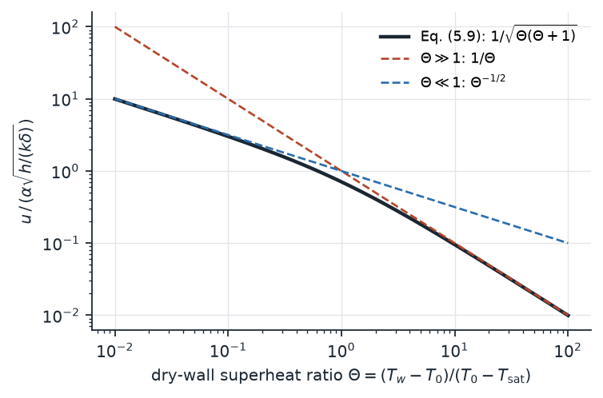

# 5. Jet quenching, rewetting and moving plates

A jet does not cool a plate uniformly. It creates a stagnation zone, a spreading liquid film
and a wetting front that travels outwards. This chapter derives the stagnation-point boundary layer, the speed
of a conduction-controlled wetting front, and the kinematics of a moving plate, and assembles them into the
synthetic quench model that generates BoilFlux's benchmarks.

## 5.1 Hydrodynamic zones of an impinging jet

| Zone | Flow | Boiling behaviour |
|---|---|---|
| stagnation / impingement zone (IZ), about 1–2 jet diameters | flow decelerates; highest pressure and thinnest boundary layer | earliest rewetting, highest \(q_\text{max}\), strongly subcooled nucleate boiling |
| radial wall jet / parallel-flow zone | thin film spreading and slowing down | wetting front travels outwards; transition boiling just behind it |
| hydraulic jump, splashing | film thickens abruptly or is lifted off by vapour | irregular, weaker cooling |
| free-flow zone (FFZ), beyond the front | liquid flows over a vapour film | film boiling, low flux |

## 5.2 The stagnation-point boundary layer

Near the stagnation point the outer flow of a round jet is, to leading order, axisymmetric stagnation flow
with radial velocity \(U(r) = C\,r\), where the strain rate \(C\) scales as \(u_j/d_j\) (jet velocity over diameter). The
boundary-layer equations admit a similarity solution (Homann flow): the viscous layer has **constant thickness**

\[
\delta_\nu \sim 2\sqrt{\nu_l / C},
\tag{5.1}
\]

independent of \(r\) (the numerical factor depends on the thickness definition). The thermal layer has thickness \(\delta_t\approx\delta_\nu\,\mathrm{Pr}^{-0.4}\) for single-phase flow, and the
stagnation-point Nusselt number scales as

\[
\mathrm{Nu}_d = \frac{h\,d_j}{k_l} \propto \mathrm{Re}_d^{1/2}\,\mathrm{Pr}^{0.4},\qquad \mathrm{Re}_d = \frac{u_j d_j}{\nu_l}.
\tag{5.2}
\]

For a 4 m/s, 3 mm water jet, \(C\sim 10^3\) s⁻¹ and \(\delta_\nu\sim 60\ \mu\)m. Two consequences follow. The heat-transfer
coefficient is **uniform** across the stagnation zone, which is why BoilFlux's synthetic model uses one boiling curve
there (IZ). And the boundary layer is thin, which by Hsu's criterion (3.10) delays nucleation and, with
subcooling, explains the high fluxes of Section 4.7.

## 5.3 The wetting front

Rewetting does not occur everywhere at once. A **wetting front** separates the wetted region, where boiling
removes heat intensely, from the dry region in film boiling. Its speed controls how long each point of the plate
stays in film boiling.

**Conduction-controlled model (Yamanouchi, 1968).** Consider a thin wall of thickness \(\delta\) and a front moving at
constant speed \(u\) into the dry region. Assume:

1. the wall is thin, so \(T\) depends only on the coordinate along it (fin approximation);
2. behind the front (wetted), heat is removed with a constant coefficient \(h\) to liquid at \(T_\text{sat}\);
3. ahead of the front (dry), heat removal is negligible;
4. the front sits where the wall temperature equals the rewetting temperature \(T_0\).

In a frame moving with the front, \(\xi = x - ut\), the temperature is steady. The energy balance of the fin,
\(\rho c\,\delta\,\partial_t T = k\delta\,\partial_{xx}T - h(T-T_\text{sat})\,\mathbb 1_{\text{wet}}\), with \(\partial_t = -u\,\mathrm d/\mathrm d\xi\), becomes

\[
\frac{\mathrm d^2\theta}{\mathrm d\xi^2} + \frac{u}{\alpha}\frac{\mathrm d\theta}{\mathrm d\xi}
- \frac{h}{k\delta}\,\theta\,\mathbb 1_{\xi<0} = 0,
\qquad \theta = T - T_\text{sat},
\tag{5.3}
\]

with the wetted region at \(\xi<0\) and the dry wall far ahead at \(T_w\).

**Dry region** (\(\xi>0\)). The equation \(\theta'' + (u/\alpha)\theta' = 0\) has the bounded solution

\[
\theta = (T_w - T_\text{sat}) - (T_w - T_0)\,e^{-u\xi/\alpha},
\tag{5.4}
\]

which takes the rewetting value \(T_0 - T_\text{sat}\) at \(\xi=0\). The exponential tail is the **precooling** of the dry
wall by conduction towards the front.

**Wet region** (\(\xi<0\)). With \(a = u/\alpha\) and \(b = h/(k\delta)\), the characteristic roots of
\(\theta'' + a\theta' - b\theta = 0\) are \(r_\pm = \tfrac12\big(-a\pm\sqrt{a^2+4b}\big)\). The solution must decay as
\(\xi\to-\infty\), so only \(r_+>0\) survives:

\[
\theta = (T_0 - T_\text{sat})\,e^{r_+\xi} .
\tag{5.5}
\]

**Matching.** Temperature is continuous by construction. Continuity of the conductive flux at \(\xi = 0\) requires
\(\theta'(0^-) = \theta'(0^+)\):

\[
r_+\,(T_0 - T_\text{sat}) = \frac{u}{\alpha}\,(T_w - T_0) .
\tag{5.6}
\]

Define the **dry-wall superheat ratio**

\[
\Theta = \frac{T_w - T_0}{T_0 - T_\text{sat}} .
\tag{5.7}
\]

Then (5.6) reads \(r_+ = a\Theta\), that is \(\sqrt{a^2+4b} = a(2\Theta+1)\). Squaring,
\(a^2 + 4b = a^2(4\Theta^2 + 4\Theta + 1)\), so \(a^2 = b/(\Theta(\Theta+1))\):

!!! theorem "Result 5.1 (speed of a conduction-controlled wetting front)"
    \[
    u = \frac{\alpha\sqrt{h/(k\delta)}}{\sqrt{\Theta(\Theta+1)}}
    = \frac{1}{\rho c}\sqrt{\frac{h\,k}{\delta}}\;\frac{1}{\sqrt{\Theta(\Theta+1)}} .
    \tag{5.8}
    \]

    For a hot wall, \(\Theta\gg1\) and \(u\approx\alpha\sqrt{h/(k\delta)}\,/\,\Theta\): doubling the superheat above the rewetting
    temperature halves the front speed.

<figure class="bf-figure" markdown>

<figcaption><b>Figure 5.1.</b> Dimensionless front speed of Eq. (5.8) and its two asymptotes.</figcaption>
</figure>

In the form \(\tfrac{1}{\rho c}\sqrt{hk/\delta}\), the result shows the role of the material: a high conductivity spreads
the precooling further ahead of the front, and a low heat capacity lets it cool faster. AA6082 at 500 °C therefore
rewets much faster than nickel at 800 °C (lower \(k\), higher \(\rho c\) and larger \(\Theta\)), which is the trend measured
by Gopalkrishna et al. (2026): nickel fronts are 2.5–3 times slower.

**Thick walls.** When the wall is not thin, conduction near the front is two-dimensional and the fin
approximation fails. If the thickness drops out of the problem, as it must when the heated region near the front
is much thinner than the wall, the only remaining length is \(k/h\). Dimensional analysis then forces

\[
u = \frac{h}{\rho c}\,F(\Theta),
\tag{5.9}
\]

independent of \(\delta\). Two-dimensional analyses (Duffey and Porthouse; Tien and Yao) confirm this limit and give
\(F\).

## 5.4 Moving plates

When the plate moves at velocity \(v\) under a stationary jet, the stagnation point moves through the plate
according to (1.16). Three effects follow.

- **Asymmetry.** On the upstream side hot plate arrives and meets the front head-on; on the downstream side
  already cooled metal leaves the jet. The rewetting physics of Section 5.3 acts in the material, so the
  upstream front advances into the hot plate at speed \(u\) relative to the material, while the material is
  carried towards the jet at speed \(v\). In the laboratory the upstream front therefore moves away from the jet
  at \(u - v\), and it **stalls** at a fixed distance from the jet when \(v\) equals the front speed (5.8).
- **Regime sequences in time.** A material point experiences a sequence of regimes that depends on its distance
  from the jet path, not only on its temperature. Regime analysis therefore orders regimes by time
  ([regime analysis](../physics/regime-analysis.md)).
- **Observation in the plate frame.** The camera sees a fixed window of the laboratory. In plate coordinates the
  observed region moves, which becomes a time-dependent mask in the inverse problem (Chapter 11).

## 5.5 The synthetic quench model

BoilFlux generates benchmark data with known ground truth by solving the direct problem (1.12) with a **boiling
boundary condition** in place of a prescribed flux:

\[
q(x,y,t) = \chi(r)\,\Big[w(r)\,q_\text{IZ}(T_s) + \big(1-w(r)\big)\,q_\text{FFZ}(T_s)\Big],
\qquad r = \big\lVert(x,y) - \mathbf x_s(t)\big\rVert,
\tag{5.10}
\]

where \(\mathbf x_s(t)\) is the moving stagnation point (1.16), \(q_\text{IZ}\) and \(q_\text{FFZ}\) are the curves (4.12) with the two
parameter sets of Section 4.8, and

\[
w(r) = \operatorname{clip}\!\left(\frac{r_\text{FFZ} - r}{r_\text{FFZ} - r_\text{IZ}},\,0,\,1\right),
\qquad
\chi(r) = \tfrac12\left[1 - \tanh\frac{r - r_\text{wet}}{\Delta_\text{wet}}\right]
\tag{5.11}
\]

blend the impingement zone into the free-flow zone and limit the liquid-covered region. Because the flux depends
on the local surface temperature, film boiling, the wetting front, transition and nucleate boiling **emerge from
the physics** rather than being prescribed. In particular, the front speed is not an input: it results from the
interplay of conduction and the boiling curve, as in Section 5.3.

**Avoiding the inverse crime.** If synthetic data were generated with the same discretisation used for the
inversion, discretisation errors would cancel and the inversion would look better than it can be on real data.
BoilFlux therefore generates data on a grid refined by a factor of 2 in every direction and in time, block-averages
onto the inversion grid, and adds Gaussian noise of known standard deviation.

!!! note "In BoilFlux"
    `boilflux.synthetic.JetQuenchScenario` implements (5.10)–(5.11) and the refinement; the BF-Bench cases in
    [Benchmark](../benchmark.md) are instances of it.

## Exercises

!!! exercise "5.1"
    Show that the dry-region profile (5.4) precools the wall over a distance \(\alpha/u\) ahead of the front, and
    evaluate it for AA6082 with \(u = 20\) mm/s.

!!! exercise "5.2"
    Using (5.8), find the ratio of front speeds for AA6082 at 500 °C and nickel at 800 °C, with \(T_0 = 450\) °C and
    600 °C respectively, equal \(h\) and \(\delta\), and properties from `boilflux.materials`.

!!! exercise "5.3"
    For which plate velocity does the upstream front stall relative to the jet in Exercise 5.2's AA6082 case
    with \(h = 3\times10^4\) W/(m² K) and \(\delta = 5\) mm?
