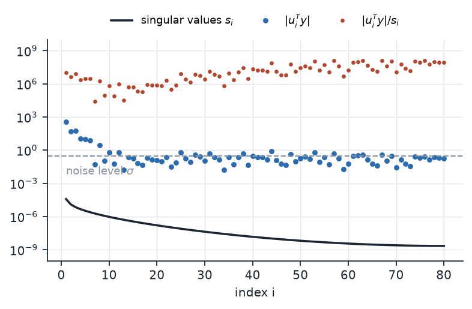

# 8. Ill-posedness

The direct problem maps a surface flux to temperatures continuously. Its inverse does not
exist as a continuous map: arbitrarily small measurement noise can be explained by arbitrarily large flux
oscillations. This chapter makes the statement precise with the singular value decomposition, introduces the
Picard condition, and measures how ill-posed the quench problem is.

## 8.1 Direct and inverse problems

The **direct problem** (1.12) maps a cause, the surface flux \(q\), to an effect, the temperature field \(T\), and in
particular to its trace on the observed face. Write this map as

\[
\mathcal F: q \mapsto T\big|_{\Gamma_c\times(0,t_f]} .
\tag{8.1}
\]

The **inverse problem** is: given noisy measurements \(Y \approx \mathcal F(q^\dagger)\) of the true flux \(q^\dagger\), find \(q^\dagger\).
Hadamard called a problem **well posed** if (i) a solution exists for all data, (ii) it is unique, and (iii) it depends
continuously on the data. The inverse quench problem fails (iii), and (i) as well: noisy data are generally not
in the range of \(\mathcal F\), since no flux produces exactly the noise pattern of a camera.

For constant properties, \(\mathcal F\) is affine. Duhamel's theorem (2.16) gives \(\mathcal F(q) = T_0 + \mathcal X q\) with the
linear integral operator

\[
(\mathcal X q)(\mathbf x, t) = \int_0^t\!\!\int_{\Gamma_j} K(\mathbf x, \mathbf x', t - \tau)\,q(\mathbf x', \tau)\,\mathrm dS'\,\mathrm d\tau ,
\tag{8.2}
\]

whose kernel \(K\) is the IR-face response to a flux impulse at \((\mathbf x',\tau)\). The kernel is smooth (infinitely
differentiable) because heat diffusion smooths everything that passes through the plate.

## 8.2 Why the inverse cannot be continuous

!!! theorem "Theorem 8.1"
    A linear integral operator with a square-integrable kernel is **compact** on \(L^2\). A compact operator
    \(\mathcal X\) between infinite-dimensional Hilbert spaces cannot have a bounded inverse on its range.

??? derivation "Proof of the second statement"
    Suppose \(\mathcal X^{-1}\) were bounded. Then the identity \(I = \mathcal X^{-1}\mathcal X\) would be compact (a bounded operator
    composed with a compact one is compact). The identity maps the unit ball onto itself, so the unit ball would be
    relatively compact. By Riesz's lemma this is true only in finite dimensions. \(\square\)

Unboundedness means there are fluxes \(\delta q\) with \(\lVert\delta q\rVert = 1\) and \(\lVert\mathcal X\delta q\rVert\) as small as we like. Chapter 2
already exhibited them: fast oscillations in time or fine patterns in space, attenuated by the factor (2.19).

## 8.3 The singular value expansion and the Picard condition

A compact operator has a **singular system** \(\{s_i, \mathbf v_i, \mathbf u_i\}\): orthonormal functions \(\mathbf v_i\) (fluxes) and \(\mathbf u_i\)
(temperature histories) and singular values \(s_1\ge s_2\ge\dots>0\) with \(s_i\to0\), such that

\[
\mathcal X\mathbf v_i = s_i\,\mathbf u_i ,\qquad \mathcal X^*\mathbf u_i = s_i\,\mathbf v_i .
\tag{8.3}
\]

Expand the data \(y = Y - T_0\) in the \(\mathbf u_i\). A solution of \(\mathcal X q = y\) must then be

\[
q = \sum_i \frac{\langle\mathbf u_i, y\rangle}{s_i}\,\mathbf v_i .
\tag{8.4}
\]

!!! theorem "Result 8.2 (Picard condition)"
    The equation \(\mathcal Xq = y\) has a square-integrable solution if and only if \(y\) lies in the closure of the range
    and

    \[
    \sum_i \frac{\langle\mathbf u_i, y\rangle^2}{s_i^2} < \infty :
    \tag{8.5}
    \]

    the data coefficients must decay faster than the singular values.

Exact data satisfy (8.5) by construction. Noisy data do not: for white noise \(e\) of standard deviation \(\sigma\), the
coefficients \(\langle\mathbf u_i,e\rangle\) have constant size \(\sigma\) (an orthogonal transformation of white noise is white
noise), while \(s_i\to0\). The terms of (8.4) belonging to noise grow like \(\sigma/s_i\) without bound. **Every inverse
method is a way of deciding which terms of (8.4) to keep.**

## 8.4 The discrete problem

After discretisation (Chapters 6–7) the unknown is a vector \(\mathbf q\in\mathbb R^n\) (one flux value per face cell and time
step) and the data a vector \(\mathbf y\in\mathbb R^m\). For constant properties the forward map is affine:

\[
\mathbf y = \mathbf X\mathbf q + \mathbf e ,
\tag{8.6}
\]

where the **sensitivity matrix** \(\mathbf X = \partial(\text{model data})/\partial\mathbf q\) has as column \(j\) the response to a unit
flux in component \(j\). Causality makes \(\mathbf X\) block lower-triangular in time; time invariance makes the blocks
depend only on the time lag (a block Toeplitz matrix). The SVD \(\mathbf X = \mathbf U\mathbf S\mathbf V^\top\)
([Appendix D](appendix-d-linear-algebra.md)) replaces (8.3), and the least-squares solution is the finite sum

\[
\mathbf q_\text{LS} = \sum_{i=1}^{n}\frac{\mathbf u_i^\top\mathbf y}{s_i}\,\mathbf v_i .
\tag{8.7}
\]

The discrete problem is formally well posed, but its **condition number** \(\kappa = s_1/s_n\) bounds the
amplification of relative data errors:

\[
\frac{\lVert\delta\mathbf q\rVert}{\lVert\mathbf q\rVert} \le \kappa\,\frac{\lVert\delta\mathbf y\rVert}{\lVert\mathbf y\rVert} .
\tag{8.8}
\]

**A worked example.** Take 5 mm of AA6082 in 1D, 10 cells through the thickness, 80 steps of 10 ms. Building \(\mathbf X\)
column by column with BoilFlux (80 forward solves) gives singular values from \(3.8\times10^{-5}\) to
\(2.2\times10^{-9}\) K per W/m², so \(\kappa = 1.75\times10^4\). With 0.3 K of noise on temperature changes of several tens of
kelvin, the bound (8.8) allows relative errors of order a hundred. In practice the unregularised solution (8.7)
has a relative error of 30, that is 3000 %.

<figure class="bf-figure" markdown>

<figcaption><b>Figure 8.1.</b> Discrete Picard plot of the 1D example. The data coefficients
\(\lvert\mathbf u_i^\top\mathbf y\rvert\) decay with the singular values only for the first ten or so indices; beyond that they stay at
the noise level \(\sigma\), and the solution coefficients \(\lvert\mathbf u_i^\top\mathbf y\rvert/s_i\) grow by orders of magnitude.</figcaption>
</figure>

The Picard plot shows where the information ends: about ten singular components carry signal, and the
remaining seventy are noise. Regularisation (Chapter 9) keeps the first and suppresses the rest.

## 8.5 How ill-posed is the quench problem?

Problems are called **mildly** ill-posed if \(s_i\) decays like a power \(i^{-p}\), and **severely** ill-posed if it decays
exponentially. For a time-invariant problem the Fourier modes are approximately singular vectors, and the
singular values are approximately the magnitudes of the transfer function (2.19). Result 2.2 gives

\[
s(\omega) \propto e^{-L\sqrt{\omega/(2\alpha)}} ,\qquad s(\kappa) \propto e^{-\kappa L} .
\tag{8.9}
\]

The quench problem with back-face measurements is therefore **severely ill-posed**, in time and even more in
space. Two practical consequences:

- **Finer is not better.** Halving the time step or the cell size adds singular values that are exponentially
  smaller; the reconstruction gains no information and becomes more sensitive to noise. The grid should resolve
  what the data can determine (about \(L\) in space and a fraction of \(t_d\) in time), not more.
- **Thinner plates and better cameras help, but only logarithmically.** Reducing noise by a factor 10 extends the
  resolvable frequency band only by \(\Delta\sqrt\omega\approx\ln 10\,\sqrt{2\alpha}/L\).

## 8.6 The nonlinear problem

With temperature-dependent properties, \(\mathcal F\) is nonlinear. Near a flux \(q\) it behaves like its derivative,
the **sensitivity operator** \(\mathcal F'(q)\), which is again an integral operator with a smooth kernel (Chapter 10). The
nonlinear problem inherits the ill-posedness of its linearisation, and the methods of Chapter 9 are applied to it
iteratively.

## Exercises

!!! exercise "8.1"
    Show that for (8.6) the least-squares solution error is \(\mathbf q_\text{LS} - \mathbf q^\dagger = \sum_i (\mathbf u_i^\top\mathbf e/s_i)\,\mathbf v_i\), and that its
    expected squared norm for white noise is \(\sigma^2\sum_i s_i^{-2}\).

!!! exercise "8.2"
    Using `docs/scripts/make_book_figures.py`, rebuild \(\mathbf X\) with \(\Delta t = 5\) ms and with 20 cells. How do
    \(s_n\) and \(\kappa\) change? Explain the result with (8.9).

!!! exercise "8.3"
    Explain why the singular vectors \(\mathbf u_i, \mathbf v_i\) with small \(i\) are smooth in time while those with large \(i\)
    oscillate. (Hint: \(\mathbf X\mathbf X^\top\) and \(\mathbf X^\top\mathbf X\) are smoothing operators.)
