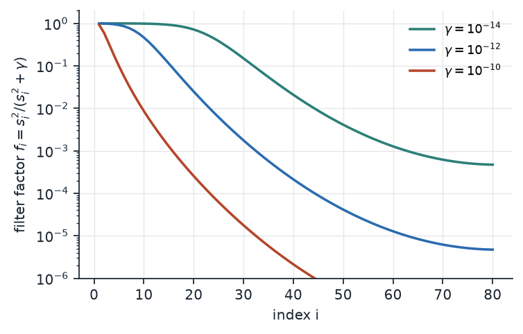
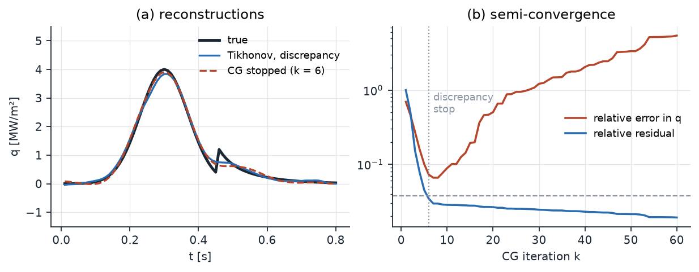

# 9. Regularisation

Regularisation replaces the ill-posed problem by a nearby well-posed one, with a parameter
that trades fidelity to the data against stability. This chapter derives Tikhonov regularisation and its
filter factors, bounds the error it makes, shows how the discrepancy principle chooses the parameter, and
explains why stopping an iterative method early is itself a regularisation, which is the approach BoilFlux
takes.

We work with the discrete linear problem (8.6), \(\mathbf y = \mathbf X\mathbf q^\dagger + \mathbf e\), its SVD
\(\mathbf X = \sum_i s_i\mathbf u_i\mathbf v_i^\top\), and the data coefficients \(\beta_i = \mathbf u_i^\top\mathbf y\). The noise is white with standard deviation
\(\sigma\), and \(m\) is the number of data, so \(\mathbb E\lVert\mathbf e\rVert^2 = m\sigma^2 =: \delta^2\).

## 9.1 Spectral filtering

Every linear regularisation method of this chapter has the form

\[
\mathbf q_\text{reg} = \sum_i f_i\,\frac{\beta_i}{s_i}\,\mathbf v_i ,
\tag{9.1}
\]

with **filter factors** \(f_i\in[0,1]\) close to 1 for large \(s_i\) (signal) and close to 0 for small \(s_i\) (noise). The
unregularised solution (8.7) has \(f_i\equiv1\). **Truncated SVD** keeps the first \(k\) terms: \(f_i = 1\) for \(i\le k\), else 0.

## 9.2 Tikhonov regularisation

!!! definition "Definition 9.1 (Tikhonov functional)"
    \[
    J_\gamma(\mathbf q) = \tfrac12\lVert\mathbf X\mathbf q - \mathbf y\rVert^2 + \tfrac{\gamma}{2}\lVert\mathbf q\rVert^2,\qquad \gamma>0 .
    \tag{9.2}
    \]

\(J_\gamma\) is strictly convex, so it has a unique minimiser, where its gradient vanishes:

\[
\nabla J_\gamma = \mathbf X^\top(\mathbf X\mathbf q - \mathbf y) + \gamma\mathbf q = \mathbf 0
\quad\Longleftrightarrow\quad
(\mathbf X^\top\mathbf X + \gamma\mathbf I)\,\mathbf q_\gamma = \mathbf X^\top\mathbf y .
\tag{9.3}
\]

Insert the SVD: \(\mathbf X^\top\mathbf X = \sum s_i^2\mathbf v_i\mathbf v_i^\top\) and \(\mathbf X^\top\mathbf y = \sum s_i\beta_i\mathbf v_i\). The matrix
\(\mathbf X^\top\mathbf X+\gamma\mathbf I\) is diagonal in the basis \(\mathbf v_i\), with entries \(s_i^2+\gamma\), so

!!! theorem "Result 9.1 (Tikhonov filter factors)"
    \[
    \mathbf q_\gamma = \sum_i \frac{s_i^2}{s_i^2 + \gamma}\,\frac{\beta_i}{s_i}\,\mathbf v_i ,
    \qquad f_i = \frac{s_i^2}{s_i^2+\gamma} .
    \tag{9.4}
    \]

    Components with \(s_i\gg\sqrt\gamma\) pass almost unchanged; components with \(s_i\ll\sqrt\gamma\) are damped by \(s_i^2/\gamma\).

<figure class="bf-figure" markdown>

<figcaption><b>Figure 9.1.</b> Tikhonov filter factors for the singular values of the 1D example of
Section 8.4, for three values of \(\gamma\).</figcaption>
</figure>

### What error does Tikhonov make?

Insert \(\beta_i = s_i\mathbf v_i^\top\mathbf q^\dagger + \mathbf u_i^\top\mathbf e\) into (9.4). The error splits into a **regularisation error** (bias)
and a **propagated noise error**:

\[
\mathbf q_\gamma - \mathbf q^\dagger = \underbrace{\sum_i (f_i - 1)\,(\mathbf v_i^\top\mathbf q^\dagger)\,\mathbf v_i}_{\text{bias, grows with }\gamma}
+ \underbrace{\sum_i f_i\,\frac{\mathbf u_i^\top\mathbf e}{s_i}\,\mathbf v_i}_{\text{noise, shrinks with }\gamma} .
\tag{9.5}
\]

The noise term is bounded uniformly. Since \((s_i - \sqrt\gamma)^2\ge0\) implies \(s_i^2+\gamma\ge 2s_i\sqrt\gamma\),

\[
\frac{f_i}{s_i} = \frac{s_i}{s_i^2+\gamma}\le\frac{1}{2\sqrt\gamma}
\quad\Longrightarrow\quad
\Big\lVert\sum_i f_i\frac{\mathbf u_i^\top\mathbf e}{s_i}\mathbf v_i\Big\rVert \le \frac{\lVert\mathbf e\rVert}{2\sqrt\gamma} .
\tag{9.6}
\]

Without regularisation (\(\gamma\to0\)) the bound is infinite; with it, the noise amplification is at most
\(1/(2\sqrt\gamma)\) no matter how small the singular values are. The best \(\gamma\) balances the two terms of (9.5).

### Smoothness instead of size

Penalising \(\lVert\mathbf q\rVert^2\) (**zeroth order**) pulls the flux towards zero. Penalising a discrete derivative,
\(\lVert\mathbf L\mathbf q\rVert^2\) with \(\mathbf L\) a first- or second-difference operator in time or space (**first or second order**),
pulls it towards constant or linear behaviour instead, and avoids biasing a large flux downwards. The normal
equations become \((\mathbf X^\top\mathbf X + \gamma\mathbf L^\top\mathbf L)\mathbf q = \mathbf X^\top\mathbf y\), analysed with the generalised SVD.

## 9.3 Choosing the parameter: the discrepancy principle

The data cannot be fitted better than the noise allows. A solution whose residual is smaller than \(\lVert\mathbf e\rVert\) must
be fitting noise; one whose residual is much larger ignores information.

!!! definition "Definition 9.2 (Morozov's discrepancy principle)"
    Choose \(\gamma\) such that

    \[
    \lVert\mathbf X\mathbf q_\gamma - \mathbf y\rVert = \tau\,\delta,\qquad \delta = \sqrt m\,\sigma,\qquad \tau\gtrsim1 .
    \tag{9.7}
    \]

The equation has exactly one solution when \(\lVert\mathbf y\rVert>\tau\delta\) and the residual of the least-squares solution is
below \(\tau\delta\). By (9.4), the residual is

\[
\lVert\mathbf X\mathbf q_\gamma - \mathbf y\rVert^2 = \sum_i\left(\frac{\gamma}{s_i^2+\gamma}\right)^2\beta_i^2 + \lVert\mathbf y_\perp\rVert^2 ,
\tag{9.8}
\]

where \(\mathbf y_\perp\) is the part of \(\mathbf y\) outside the range of \(\mathbf X\). Every term increases with \(\gamma\), so the residual is
strictly increasing and (9.7) can be solved by bisection. The safety factor \(\tau\) (BoilFlux uses 1.02) accounts for the
fact that \(\lVert\mathbf e\rVert\) fluctuates around \(\delta\). The principle needs the noise level, which BoilFlux estimates from the
data when it is not given (Section 11.5).

Other rules choose \(\gamma\) without knowing \(\sigma\): the **L-curve** (the corner of
\(\log\lVert\mathbf q_\gamma\rVert\) against \(\log\lVert\mathbf X\mathbf q_\gamma-\mathbf y\rVert\)) and **generalised cross-validation**, which minimises
\(\lVert\mathbf X\mathbf q_\gamma - \mathbf y\rVert^2/(m - \sum_i f_i)^2\). They are useful when the noise model is unreliable; when it is reliable, the
discrepancy principle is better founded.

In the 1D example of Section 8.4 (0.3 K noise), the discrepancy principle selects \(\gamma = 8.3\times10^{-13}\) and the
reconstruction has a relative error of 7.1 %, compared with 3000 % without regularisation (Figure 9.2a).

## 9.4 Iterative regularisation

Iterative methods for the normal equations start from \(\mathbf q_0 = \mathbf 0\) and add detail step by step. Large singular
components converge first and small ones last. Stopping early therefore acts as a filter.

**Landweber iteration.** The steepest-descent iteration for \(\tfrac12\lVert\mathbf X\mathbf q-\mathbf y\rVert^2\) with a fixed step \(\omega\),

\[
\mathbf q_{k+1} = \mathbf q_k + \omega\,\mathbf X^\top(\mathbf y - \mathbf X\mathbf q_k),\qquad 0<\omega<2/s_1^2,
\tag{9.9}
\]

acts on each SVD component separately. In the basis \(\mathbf v_i\), component \(i\) obeys
\(c_{k+1} = (1-\omega s_i^2)\,c_k + \omega s_i\beta_i\), whose solution from \(c_0=0\) is
\(c_k = [1-(1-\omega s_i^2)^k]\,\beta_i/s_i\). Hence

\[
f_i^{(k)} = 1 - (1 - \omega s_i^2)^k .
\tag{9.10}
\]

After \(k\) iterations, components with \(\omega s_i^2 k\gg1\) are fully recovered and components with \(\omega s_i^2k\ll1\) are damped
by \(\omega s_i^2 k\): the iteration count plays the role of \(1/\gamma\).

**Conjugate gradients.** The conjugate-gradient method applied to the normal equations (CGLS) builds the iterate
\(\mathbf q_k\) that minimises the residual over the Krylov subspace
\(\operatorname{span}\{\mathbf X^\top\mathbf y, (\mathbf X^\top\mathbf X)\mathbf X^\top\mathbf y,\dots,(\mathbf X^\top\mathbf X)^{k-1}\mathbf X^\top\mathbf y\}\). It also captures large singular
components first, but far faster than Landweber: its filter factors are polynomials in \(s_i^2\) chosen optimally for the
data. The price is that they are not known in closed form, and the method must be stopped by a rule.

!!! theorem "Result 9.2 (semi-convergence)"
    For noisy data, the error \(\lVert\mathbf q_k - \mathbf q^\dagger\rVert\) of CGLS and Landweber first decreases, reaches a minimum, and then
    increases as noise components enter, while the residual keeps decreasing. Stopping at the first \(k\) with
    \(\lVert\mathbf X\mathbf q_k - \mathbf y\rVert\le\tau\delta\) (the discrepancy principle as a stopping rule) yields a regularisation method:
    the reconstruction converges to \(\mathbf q^\dagger\) as \(\delta\to0\).

<figure class="bf-figure" markdown>

<figcaption><b>Figure 9.2.</b> (a) Reconstructions of the 1D example: Tikhonov with the discrepancy principle
(7.1 % error) and conjugate gradients stopped by the discrepancy principle after 6 iterations (7.3 %). (b) CG
semi-convergence: the residual decreases monotonically while the error is smallest at iteration 8 (6.6 %) and
then grows. The discrepancy stop lands close to the optimum without knowing the true flux.</figcaption>
</figure>

## 9.5 What BoilFlux does

BoilFlux minimises the misfit with an optional zeroth-order Tikhonov term,

\[
J(\mathbf p) = \tfrac12\sum_n\lVert\mathbf M_n(\mathbf H\mathbf T^n(\mathbf p) - \mathbf Y^n)\rVert^2 + \tfrac\gamma2\lVert\mathbf p\rVert^2,
\qquad \mathbf p = \mathbf q / (10^6\ \mathrm{W/m^2}),
\tag{9.11}
\]

by nonlinear conjugate gradients (Chapter 11), and stops by the discrepancy principle. The default is \(\gamma=0\):
the **iteration count is the regularisation parameter**. A positive \(\gamma\) adds Tikhonov damping on top. Note that \(\gamma\)
weights the flux in MW/m², so its numerical value is \(10^{12}\) times larger than the equivalent weight on \(\mathbf q\) in W/m².

## Exercises

!!! exercise "9.1"
    Show that the Tikhonov solution (9.4) also minimises \(\lVert\mathbf q\rVert\) subject to
    \(\lVert\mathbf X\mathbf q - \mathbf y\rVert\le\lVert\mathbf X\mathbf q_\gamma - \mathbf y\rVert\). (Hint: Lagrange multipliers; \(\gamma\) is the inverse multiplier.)

!!! exercise "9.2"
    For Landweber with \(\omega = 1/s_1^2\), how many iterations are needed for \(f_i^{(k)}\ge\tfrac12\) at
    \(s_i = 10^{-2}s_1\)? Compare with the 6 iterations CG needs in Figure 9.2.

!!! exercise "9.3"
    Derive the GCV function from leave-one-out cross-validation for a linear smoother \(\mathbf X\mathbf q_\gamma = \mathbf A_\gamma\mathbf y\).
