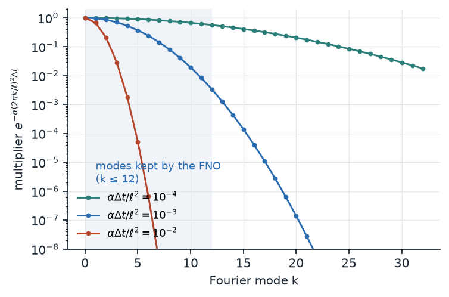

# 14. Neural operators

A PINN learns one solution. A neural operator learns the solution map itself, for example
from the state of a boiling flow to its next state, and is then evaluated in milliseconds for new conditions.
This chapter derives the Fourier neural operator from the Green's function of the heat equation, states the
approximation theorem behind DeepONet, and analyses the autoregressive boiling surrogate in BoilFlux, including
why its errors grow along a rollout.

## 14.1 Learning maps between functions

Let \(a\) be an input function (an initial field, a boundary flux history, the heater temperature) and \(u\) the
corresponding solution. The PDE defines a **solution operator** \(\mathcal G: a\mapsto u\) between function spaces. Operator
learning approximates \(\mathcal G\) by \(\mathcal G_\theta\) from examples \(\{(a_i, u_i)\}\) produced by a solver:

\[
\min_\theta\ \frac1N\sum_{i=1}^N\big\lVert\mathcal G_\theta(a_i) - u_i\big\rVert^2 .
\tag{14.1}
\]

Once trained, \(\mathcal G_\theta\) answers new queries without solving the PDE. For boiling, where an interface-resolved
simulation takes hours, this is the attraction.

## 14.2 The heat equation's solution operator is a convolution

Take \(\partial_t T = \alpha\,\partial_{xx}T\) on the real line, and its Fourier transform
\(\hat T(\kappa,t) = \int T(x,t)\,e^{-\mathrm i\kappa x}\,\mathrm dx\). Since \(\widehat{\partial_{xx}T} = -\kappa^2\hat T\), every Fourier mode evolves
independently:

\[
\partial_t\hat T = -\alpha\kappa^2\,\hat T
\quad\Longrightarrow\quad
\hat T(\kappa, t+\Delta t) = e^{-\alpha\kappa^2\Delta t}\,\hat T(\kappa, t) .
\tag{14.2}
\]

Multiplication in Fourier space is convolution in physical space (the convolution theorem), so

\[
T(x, t+\Delta t) = \int_{-\infty}^{\infty} G_{\Delta t}(x - y)\,T(y,t)\,\mathrm dy,\qquad
G_{\Delta t}(x) = \frac{1}{\sqrt{4\pi\alpha\Delta t}}\,e^{-x^2/(4\alpha\Delta t)} .
\tag{14.3}
\]

Three observations motivate the architecture that follows. The step operator is an **integral operator** with a
translation-invariant kernel. It is **diagonal in Fourier space**. And its Fourier multiplier decays like
\(e^{-\alpha\kappa^2\Delta t}\), so a few low modes carry almost all of it.

<figure class="bf-figure" markdown>

<figcaption><b>Figure 14.1.</b> Fourier multiplier of one heat-equation step on a periodic domain of length \(\ell\),
for three diffusion numbers. Modes above \(k\approx 12\) (shaded: kept by the BoilFlux FNO) are already damped by many
orders of magnitude at \(\alpha\Delta t/\ell^2 = 10^{-3}\).</figcaption>
</figure>

## 14.3 The Fourier neural operator

A neural operator alternates learned integral operators with pointwise nonlinearities, generalising (14.3) to
nonlinear problems:

\[
v_{l+1}(\mathbf x) = \sigma\Big(\mathbf W_l\,v_l(\mathbf x) + \int\boldsymbol\kappa_l(\mathbf x - \mathbf y)\,v_l(\mathbf y)\,\mathrm d\mathbf y\Big),
\tag{14.4}
\]

where \(v_l(\mathbf x)\in\mathbb R^{c}\) is a field of \(c\) hidden channels, \(\mathbf W_l\in\mathbb R^{c\times c}\) acts pointwise and \(\boldsymbol\kappa_l\) is a matrix-valued
kernel. The **Fourier neural operator** (FNO; Li et al., 2021) parametrises the kernel by its Fourier coefficients and
keeps only the lowest modes:

\[
\int\boldsymbol\kappa_l(\mathbf x-\mathbf y)\,v_l(\mathbf y)\,\mathrm d\mathbf y = \mathcal F^{-1}\big(\mathbf R_l\cdot\mathcal F v_l\big),
\qquad (\mathbf R_l)_{\mathbf k}\in\mathbb C^{c\times c},\quad \mathbf R_{l,\mathbf k} = 0\ \text{for}\ \lvert k_x\rvert, \lvert k_y\rvert > k_\text{max} .
\tag{14.5}
\]

On a grid, \(\mathcal F\) is the fast Fourier transform. The discrete convolution theorem
(\(\widehat{\kappa\circledast v} = \hat\kappa\odot\hat v\) for circular convolution) makes (14.5) exact for the discretised kernel, at cost
\(O(n\log n)\) per channel. By Section 14.2, a single linear Fourier layer can represent one constant-coefficient
heat step exactly. The nonlinearity and the pointwise path \(\mathbf W_l\) let a stack of layers represent
variable coefficients, interfaces and advection.

Because the learned parameters are attached to Fourier modes and not to grid points, the same operator can be
evaluated on a finer or coarser grid (**discretisation invariance**). In practice accuracy degrades when the new grid
resolves features the training data did not contain.

**Non-periodic domains.** The FFT assumes periodicity. The boiling domain has a heated wall at the bottom and an
outflow at the top. BoilFlux pads the hidden fields with zeros before the Fourier layers and crops afterwards, so the
implied periodic images do not interact with the physical domain.

!!! note "In BoilFlux"
    `boilflux.operators.fno.FNO2d`: a pointwise lift of the input channels plus two coordinate channels to width
    32; four Fourier layers with \(k_\text{max} = 12\) modes in each direction (two blocks, for positive and negative \(k_y\),
    because the real FFT stores only half the \(k_x\) range), each followed by GELU except the last; zero padding of 8
    cells; a two-layer pointwise projection. The spectral weights number
    \(4\times2\times32\times32\times12\times12 = 1\,179\,648\) complex values, which with the pointwise layers gives the quoted
    1.19 M parameters (as PyTorch counts them, one per complex weight).

## 14.4 DeepONet

A different construction separates the input function from the query point. A **branch** network \(\mathbf b\) reads the
input function at \(m\) fixed sensor points, a **trunk** network \(\mathbf t\) reads the query coordinate \(\mathbf y\), and

\[
\mathcal G_\theta(a)(\mathbf y) = \sum_{k=1}^{p} b_k\big(a(\mathbf x_1),\dots,a(\mathbf x_m)\big)\,t_k(\mathbf y) + b_0 .
\tag{14.6}
\]

!!! theorem "Theorem 14.1 (universal approximation of operators; Chen and Chen, 1995)"
    Let \(\mathcal G\) be a continuous operator from a compact set of continuous functions to continuous functions. For
    every \(\varepsilon>0\) there are \(m\), \(p\), sensor points and networks \(\mathbf b, \mathbf t\) with one hidden layer such that (14.6)
    approximates \(\mathcal G(a)(\mathbf y)\) to within \(\varepsilon\), uniformly in \(a\) and \(\mathbf y\).

DeepONet suits parametric maps with few inputs and arbitrary query points, for example jet velocity, subcooling
and plate temperature mapped to a wall-flux field. FNO suits field-to-field maps on grids, such as one time step of a
flow.

## 14.5 The autoregressive boiling surrogate in BoilFlux

The prototype learns the evolution of 2D interface-resolved nucleate boiling (BubbleML data; see the
[neural-operator prototype](../physics/neural-operators.md)). The state is \(\mathbf s = (T, u, v, \phi)\) with the level set \(\phi\)
clipped to \(\pm1\). The model predicts the **increment** from the last four frames and the heater temperature:

\[
\mathbf s^{n+1} = \mathbf s^n + \mathcal G_\theta\big(\mathbf s^{n-3},\dots,\mathbf s^n;\ T_\text{wall}\big).
\tag{14.7}
\]

Predicting increments rather than states lets the network learn the small change per step, which is better
conditioned. Inputs are normalised per channel with the training mean and standard deviation, and increments
with their own statistics.

**Training.** AdamW with a one-cycle schedule for 25 epochs, weight 2 on the interface channel, and a **two-step
unrolled loss**: the model is applied twice, feeding its first prediction back as input, and the errors of both steps
are averaged. This exposes the model during training to its own (imperfect) outputs.

**Why errors grow along a rollout.** Let \(\Phi\) be the true one-step map, \(\Phi_\theta\) the learned one with one-step error
\(\lVert\Phi_\theta(\mathbf s) - \Phi(\mathbf s)\rVert\le\varepsilon\) on the relevant states, and \(\Lambda\) a Lipschitz constant of \(\Phi_\theta\). The rollout error
\(e_n = \lVert\hat{\mathbf s}^n - \mathbf s^n\rVert\) satisfies

\[
e_{n+1} \le \lVert\Phi_\theta(\hat{\mathbf s}^n) - \Phi_\theta(\mathbf s^n)\rVert + \lVert\Phi_\theta(\mathbf s^n) - \Phi(\mathbf s^n)\rVert
\le \Lambda\,e_n + \varepsilon
\quad\Longrightarrow\quad
e_n \le \varepsilon\,\frac{\Lambda^n - 1}{\Lambda - 1} .
\tag{14.8}
\]

For \(\Lambda>1\) the bound grows geometrically. Worse, \(\varepsilon\) is small only on states like the training data; as errors
accumulate, the model sees states it was never trained on (**distribution shift**), and the effective \(\varepsilon\) grows too.
Unrolled training reduces exactly this: it trains on the model's own outputs. Noise injection and longer unrolls go
further.

**Results.** On the held-out heater temperature of 94 °C, over 80 steps: 3.6 % mean relative error of the heater
heat flux, 0.87 mean intersection-over-union of the vapour region, and relative \(L^2\) errors of the temperature that
grow from 0.053 over the first 5 steps to 0.16 over all 80, consistent with (14.8). The heat flux is computed from the
near-wall gradient, \(q_w\propto\langle(T_\text{wall} - T_1)/y_1\rangle\) averaged over the heater.

## 14.6 Limits

- **Stochastic nucleation.** Which cavity fires, and when, depends on details below the model's resolution. A
  deterministic operator can predict statistics and timing on average, not individual events.
- **Generalisation.** The prototype interpolates between heater temperatures of 87–103 °C in pool boiling of FC-72.
  Quenching involves film and transition boiling at hundreds of kelvin of superheat, for which training data must
  first be generated (Chapter 16).
- **Conservation.** Nothing in (14.4) enforces conservation of mass or energy. Physics-informed losses or
  conservative output layers can add it.

## Exercises

!!! exercise "14.1"
    Show that one Fourier layer with \(\mathbf W = 0\), identity activation, one channel and
    \(R_k = e^{-\alpha(2\pi k/\ell)^2\Delta t}\) for \(\lvert k\rvert\le k_\text{max}\) reproduces a heat step up to the truncated modes. Bound the
    truncation error for a smooth initial field.

!!! exercise "14.2"
    Derive (14.8) by induction and evaluate it for \(\varepsilon = 0.01\), \(\Lambda = 1.02\) and \(n = 80\).

!!! exercise "14.3"
    Explain why predicting increments in (14.7) is equivalent to a residual connection, and why it improves the
    conditioning of training.
