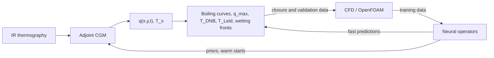

# 16. Hybrid physics–ML inversion and open problems

The two halves of this book meet here. Physics-based inversion is reliable and well
understood but cannot recover what the plate filters out. Learned models are fast and can carry information
from simulations, but they are only as good as their training data. This chapter shows, with the tools of
Chapters 9, 10 and 15, exactly where a learned component helps an inversion and where it only adds bias,
and closes with the open problems that BoilFlux is built to address.

## 16.1 What a prior can and cannot add

Start the conjugate-gradient iteration of Chapter 9 from an initial flux \(\mathbf q_0\) instead of zero, for the linear
problem. CGLS started at \(\mathbf q_0\) is CGLS applied to the residual data \(\mathbf y - \mathbf X\mathbf q_0\), plus \(\mathbf q_0\). Writing its filter factors as
\(f_i^{(k)}\) (Section 9.4),

\[
\mathbf q_k = \mathbf q_0 + \sum_i f_i^{(k)}\,\frac{\mathbf u_i^\top(\mathbf y - \mathbf X\mathbf q_0)}{s_i}\,\mathbf v_i
= \sum_i\Big[f_i^{(k)}\,\frac{\mathbf u_i^\top\mathbf y}{s_i} + \big(1 - f_i^{(k)}\big)\,\mathbf v_i^\top\mathbf q_0\Big]\mathbf v_i .
\tag{16.1}
\]

!!! theorem "Result 16.1 (where a warm start acts)"
    In components that the data determine (\(f_i\approx1\)), the reconstruction ignores the initial guess. In components the
    data cannot determine (\(f_i\approx0\)), it **is** the initial guess. The same holds for the Tikhonov solution with prior mean
    \(\mathbf q_0\) (Result 15.1).

This is the precise statement behind using a neural-operator prediction as a prior or warm start. A good prior
improves exactly the fine-scale and fast content that back-face data cannot resolve, such as the sharpness of the
rewetting surge and the peak flux. A biased prior transfers its bias into those components, invisibly, because the
data cannot contradict it. A hybrid method must therefore report how much of the result came from the data
(Section 15.3: the averaging kernels and \(\operatorname{tr}\mathbf R\)) and how much from the prior.

## 16.2 Learned regularisers

More generally, replace the Tikhonov term by a learned negative log-prior,

\[
\min_{\mathbf q}\ \tfrac12\sum_n\lVert\mathbf M_n(\mathbf H\mathbf T^n(\mathbf q) - \mathbf Y^n)\rVert^2 + \mathcal R_\phi(\mathbf q) ,
\tag{16.2}
\]

where \(\mathcal R_\phi\) is trained on fluxes from simulations or earlier reconstructions. Choices range from a Gaussian with a
learned covariance (still convex; Section 15.2 applies) to generative models whose latent space parametrises
plausible flux fields. The adjoint gradient of Chapter 10 is unchanged; only \(\nabla\mathcal R_\phi\), available by automatic
differentiation, is added. Convexity, and with it uniqueness, is generally lost for non-Gaussian priors.

## 16.3 Surrogates inside the inverse loop, and verification

A neural operator can also replace the **forward** solver: \(\mathbf T\approx\mathcal G_\theta(\mathbf q)\), with gradients from back-propagation.
This makes each iteration cheap, but the surrogate's error is then a model error (Section 15.6) that the discrepancy
principle cannot distinguish from signal. The safeguard is **verification with the physics model**:

!!! definition "Definition 16.1 (verifier-gated surrogate inversion)"
    Accept a flux \(\mathbf q_\text{s}\) obtained with a surrogate only if the **physics** forward model reproduces the data at the
    noise level,

    \[
    \sum_n\big\lVert\mathbf M_n\big(\mathbf H\mathbf T^n_\text{physics}(\mathbf q_\text{s}) - \mathbf Y^n\big)\big\rVert^2 \le \tau^2N_\text{obs}\sigma^2 ,
    \tag{16.3}
    \]

    and otherwise use \(\mathbf q_\text{s}\) as a warm start for the adjoint CGM, which then corrects it with the exact model.

The test costs one forward solve, and it guarantees that every accepted result is consistent with the conduction
physics and the data. What it cannot guarantee is correctness in the unresolved components, for the reason of
Result 16.1. This is the design behind the verifier-gated method-selection agent on the [roadmap](../roadmap.md).

## 16.4 Differentiable physics

The forward solver of Chapters 6–7 can be embedded in an automatic-differentiation framework, with the discrete
adjoint (10.12) registered as its vector–Jacobian product. Gradients then flow through the physics exactly and
cheaply, and the solver can be combined with learned components: a learned boiling-curve parametrisation trained
end to end against IR data, or a correction model for unresolved physics. The adjoint derivation of Chapter 10 and
back-propagation in Chapter 12 are the same operation; differentiable physics only connects them in software.

## 16.5 Closing the loop with boiling physics

Inverse reconstructions provide **measured** local boiling curves and wetting-front kinematics (Part II), which are the
closure data that wall-boiling models in CFD lack beyond critical heat flux. CFD in turn provides the training data
for neural operators, which return as priors and warm starts to the inversion, under the verification of Section 16.3.

## 16.6 Open problems

1. **Training data for the quench regime.** Neural operators exist for pool nucleate boiling. Film and transition boiling
   with rewetting fronts at hundreds of kelvin superheat need conjugate heat-transfer simulations that are validated
   against reconstructions.
2. **Exact gradients for strongly temperature-dependent properties.** Section 10.6: implement the full linearisation.
3. **Uncertainty as standard output.** Low-rank Laplace approximations (Section 15.4) at a cost of a few dozen extra
   solves.
4. **Joint estimation.** Flux together with contact resistance, emissivity or unknown property tables.
5. **Front-face resolution.** Combining back-face IR inversion with front-face measurements or high-speed imaging of the
   wetting front, to constrain exactly the components that Result 16.1 leaves to the prior.
6. **Open experimental data.** A public IR quench dataset with independent flux measurements, so that methods can be
   validated, and not only verified, on common data.

## Exercises

!!! exercise "16.1"
    Derive the second form of (16.1) from the first.

!!! exercise "16.2"
    For the 1D example, construct a biased prior \(\mathbf q_0 = 0.8\,\mathbf q^\dagger\) and a sharpened one, run CGLS from each, and
    measure the error in the resolved and unresolved subspaces separately.

!!! exercise "16.3"
    Argue that the verification test (16.3) can accept a wrong flux, and characterise the set of fluxes it cannot
    reject using the singular vectors of \(\mathbf X\).
