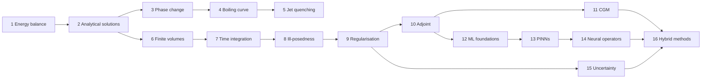

# The BoilFlux book

Inverse heat transfer for boiling and quenching, from the energy balance to neural
operators. Every result used by BoilFlux is derived here from first principles, with the assumptions stated
and the code that implements it named.

## Who this book is for

The book is written for graduate students, researchers and engineers who want to understand, and not only
run, inverse heat-conduction and scientific-machine-learning methods for quenching. It assumes:

- calculus in several variables and ordinary differential equations
- basic linear algebra (matrices, eigenvalues, least squares)
- an undergraduate course in heat transfer is helpful but not required; Part I rebuilds what is needed

Everything else is developed in the text. The appendices collect the vector calculus, the calculus of
variations and the linear algebra that the derivations rely on.

## How the book is organised

Part I
**Heat conduction**

1. [Conservation of energy and Fourier's law](01-energy-conservation.md)
2. [Analytical solutions and characteristic scales](02-analytical-solutions.md)

Part II
**Boiling and quenching**

3. [Thermodynamics of phase change and nucleation](03-phase-change.md)
4. [The boiling curve](04-boiling-curve.md)
5. [Jet quenching, rewetting and moving plates](05-jet-quenching.md)

Part III
**Numerical solution of the direct problem**

6. [Finite-volume discretisation](06-finite-volumes.md)
7. [Time integration, nonlinearity and verification](07-time-integration.md)

Part IV
**Inverse heat conduction**

8. [Ill-posedness](08-ill-posedness.md)
9. [Regularisation](09-regularisation.md)
10. [Sensitivity and adjoint problems](10-adjoint.md)
11. [The conjugate-gradient method in BoilFlux](11-cgm.md)

Part V
**Scientific machine learning**

12. [Learning from data: networks, gradients and optimisation](12-ml-foundations.md)
13. [Physics-informed neural networks](13-pinns.md)
14. [Neural operators](14-neural-operators.md)

Part VI
**Uncertainty and hybrid methods**

15. [Bayesian inverse problems and uncertainty](15-uncertainty.md)
16. [Hybrid physics–ML inversion and open problems](16-hybrid-outlook.md)

**Appendices.** [A. Notation and units](appendix-a-notation.md) ·
[B. Vector calculus and integral theorems](appendix-b-vector-calculus.md) ·
[C. Calculus of variations](appendix-c-variations.md) ·
[D. Linear algebra for inverse problems](appendix-d-linear-algebra.md)

## Reading paths

- **Inverse heat conduction only:** Chapters 1, 2, 6–11, 15.
- **Boiling physics only:** Chapters 1–5.
- **Scientific machine learning:** Chapters 1, 2, 8–10, then 12–14 and 16. Chapter 10 matters here:
  back-propagation is the adjoint method of Chapter 10 applied to a network (Section 12.3).

## Conventions

- Equations are numbered by chapter, as in (8.4). Definitions, theorems and derivations are set in boxes;
  long derivations can be collapsed.
- SI units throughout; temperatures in kelvin inside thermodynamic formulas and in °C in the code. Where
  the difference matters it is stated.
- A **positive heat flux \(q\) leaves the plate** through the quenched face, as in BoilFlux and in
  Gopalkrishna et al. (2026).
- Bold lower-case letters are vectors, bold upper-case letters matrices. The full notation list is in
  [Appendix A](appendix-a-notation.md).
- Paragraphs marked **In BoilFlux** name the module and function that implement the result.

!!! note "Reproducibility"
    All figures in the book are produced by `docs/scripts/make_book_figures.py` from closed-form results
    or from BoilFlux itself. Numbers quoted in the text come from that script.

## Citing the book

Cite the book together with the software (see [Cite BoilFlux](../community/citing.md)). The method of
Part IV follows S.B. Gopalkrishna, A.K. Nallathambi, E. Specht, *Applied Thermal Engineering* 304 (2026)
132481.
