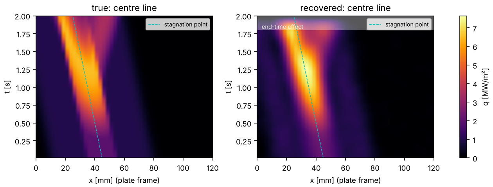

---
hide:
  - navigation
  - toc
---

<div class="bf-hero" markdown>

# BoilFlux

<p class="bf-tagline">Open inverse heat transfer for boiling and quenching. Reconstruct the transient,
spatially resolved boiling heat flux on a quenched, moving hot plate from infrared thermography of its
back face, with a nonlinear 3D model and the adjoint conjugate-gradient method.</p>

[Get started](getting-started.md){ .md-button .md-button--primary }
[Read the theory](theory/index.md){ .md-button }
[View on GitHub](https://github.com/boilflux/boilflux){ .md-button }

<div class="bf-badges"><span>MIT licence</span><span>Python ≥ 3.10</span><span>3D · nonlinear · moving plate</span><span>adjoint CGM</span><span>benchmarks with ground truth</span></div>

</div>

## Why BoilFlux

The heat flux on a quenched surface cannot be measured directly: water jets, vapour films and
temperatures up to 1000 °C destroy any sensor. It has to be inferred from temperatures measured
elsewhere, which is an ill-posed **inverse heat conduction problem (IHCP)**. The methods are well
established, but there has been no maintained, open, boiling-specific software for them. Every
group writes its own code, and results cannot be compared on common data.
BoilFlux is meant to close that gap.

<div class="bf-grid" markdown>

<div class="bf-card" markdown>
<span class="bf-icon">:material-cube-outline:</span>
### Nonlinear 3D model
Finite-volume conduction in a thick plate with temperature-dependent \(k, \rho, c_p\). Use
`ny = 1` for the 2D model of the 2026 paper.
</div>

<div class="bf-card" markdown>
<span class="bf-icon">:material-arrow-right-bold-outline:</span>
### Moving plates
Solved in the plate frame, so there is no advection term. The jet stagnation point moves and the
camera field of view becomes a time-dependent observation mask.
</div>

<div class="bf-card" markdown>
<span class="bf-icon">:material-function-variant:</span>
### Adjoint CGM
Exact discrete adjoint and sensitivity problems, Polak–Ribière directions, Tikhonov
regularisation and stopping by the discrepancy principle.
</div>

<div class="bf-card" markdown>
<span class="bf-icon">:material-camera-outline:</span>
### Built for IR thermography
Resamples lab-frame frames onto the plate, estimates noise robustly, masks bad pixels and models
radiation and convection losses.
</div>

<div class="bf-card" markdown>
<span class="bf-icon">:material-chart-bell-curve:</span>
### Boiling physics
Specht parabolic boiling curve with impingement and free-flow zones. Film, transition and
nucleate boiling and the rewetting front come out of the model rather than being prescribed.
</div>

<div class="bf-card" markdown>
<span class="bf-icon">:material-fire:</span>
### Regime analysis
Maps the maximum heat flux, the DNB and Leidenfrost (rewetting) temperatures, film, transition and
nucleate boiling zones, and wetting-front speeds. See the [physics guide](physics/index.md).
</div>

<div class="bf-card" markdown>
<span class="bf-icon">:material-waves:</span>
### Neural operators for boiling flow
A Fourier neural operator trained on interface-resolved boiling CFD predicts bubbles, temperature and
wall heat flux in milliseconds. See the [prototype](physics/neural-operators.md).
</div>

<div class="bf-card" markdown>
<span class="bf-icon">:material-trophy-outline:</span>
### BF-Bench
Reproducible synthetic quench cases with known ground-truth flux, generated on a refined grid to
avoid the inverse crime, with standard scores.
</div>

</div>

## A moving-plate quench reconstructed

<figure class="bf-figure" markdown>

<figcaption>Benchmark case <code>M3D-AA6082</code>: AA6082 plate at 500 °C moving at 10 mm/s under a
single round jet. Left: ground-truth heat flux along the centre line in the plate frame.
Right: BoilFlux reconstruction from noisy back-face IR data (σ = 2 K). The dashed line is the
moving stagnation point.</figcaption>
</figure>

## Try it in a minute

```bash
pip install boilflux          # or: pip install git+https://github.com/boilflux/boilflux
boilflux demo                 # synthetic moving-plate quench -> inversion -> figures
boilflux bench                # run all BF-Bench cases and print the score table
```

```python
import boilflux as qf

data = qf.JetQuenchScenario(material="AA6082", T0=500.0, plate_velocity=0.01).generate()
result = qf.AdjointCGM(data).solve()
print(qf.flux_metrics(result.q[result.reliable], data.q_true[result.reliable]))
```

## Built on published science

BoilFlux implements and extends the method of

> S.B. Gopalkrishna, A.K. Nallathambi, E. Specht, *Inverse heat conduction method to estimate heat
> flux during quenching of hot metals with infrared thermography measurements*, **Applied Thermal
> Engineering** 304 (2026) 132481. [doi:10.1016/j.applthermaleng.2026.132481](https://doi.org/10.1016/j.applthermaleng.2026.132481)

The [roadmap](roadmap.md) adds neural-operator priors, a verifier-gated agent for method
selection, uncertainty quantification and an open experimental IR quench dataset.
