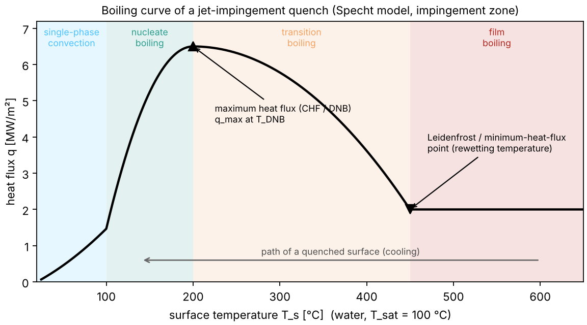

# Boiling physics: the boiling curve

A hot metal surface in contact with water passes through up to four heat-transfer regimes. Each one
has a different mechanism and a heat flux that differs by orders of magnitude. QuenchFlux
reconstructs this boiling heat flux, so the physics below explains what its results show.

<figure class="qf-figure" markdown>

<figcaption>Boiling curve of the impingement zone of a water jet (Specht parabolic model, parameters of
the ATE 2026 paper). A quenched surface moves along it from right to left. Reproduce with
<code>docs/scripts/make_physics_figures.py</code>.</figcaption>
</figure>

## The four regimes at a glance

| Regime | Surface temperature (water, 1 atm, jet) | What happens at the wall | Heat flux |
|---|---|---|---|
| **Film boiling** | above the Leidenfrost point (≈ 300–650 °C under jets) | a continuous vapour film separates the liquid from the wall; heat crosses the vapour by conduction and radiation | low: 0.1–2 MW/m² |
| **Transition boiling** | between \(T_\text{Leid}\) and \(T_\text{DNB}\) | intermittent liquid–solid contact; dry patches and wetted patches alternate | rises steeply as the wall cools |
| **Nucleate boiling** | from onset of nucleate boiling to \(T_\text{DNB}\) | discrete bubbles nucleate at cavities, grow and depart; latent heat and liquid agitation | highest; peaks at the maximum heat flux |
| **Single-phase convection** | below boiling incipience | forced convection of the jet liquid | moderate, falling with \(T_s\) |

The two turning points define the boiling curve:

- **Maximum heat flux (MHF)**, called critical heat flux (CHF) in heat-controlled systems, at the temperature
  of **departure from nucleate boiling (DNB)**.
- **Minimum heat flux / Leidenfrost point**, where the vapour film can no longer be sustained. In a
  quench this is the **rewetting temperature**: the liquid touches the wall and a wetting front starts.

## Heat-flux control vs temperature control vs quenching

The boiling curve was first measured by Nukiyama (1934) with an electrically heated wire. Under
**heat-flux control**, exceeding CHF makes the wall temperature jump to the film branch. This is the
"burnout" or boiling crisis, and the transition branch cannot be observed. Under **temperature control** (for example
condensing-vapour heating, as in Drew and Mueller's experiments) the full curve is accessible.

**Quenching** is a third situation. The wall has no heat source, its temperature falls continuously,
and every regime is passed through in reverse order (film → transition → nucleate → convection). Two
consequences matter for interpretation:

1. **The curve is transient and history-dependent.** It depends on the cooling rate, the jet
   conditions and the solid's thermal properties. Quench and steady-state boiling curves differ.
2. **The surface temperature is itself unknown.** It changes over sub-millimetre distances near the
   wetting front. That is why the problem is posed as an inverse problem on the full temperature field.

## Read on

- [Nucleate boiling, CHF and DNB](nucleate-chf.md): bubble mechanisms, heat-flux partitioning, hydrodynamic and dry-spot CHF theories
- [Transition boiling, Leidenfrost and film boiling](leidenfrost-film.md): vapour-film stability, homogeneous nucleation, contact temperature, Berenson and Bromley
- [Quenching and rewetting](quenching.md): jet zones, wetting-front propagation, moving plates, material effects, and what the inverse solution can resolve
- [Modelling: CFD, OpenFOAM, PINNs and neural operators](modelling.md)
- [Regime analysis in QuenchFlux](regime-analysis.md): extracting \(q_\text{max}, T_\text{DNB}, T_\text{Leid}\) and wetting fronts from reconstructions
