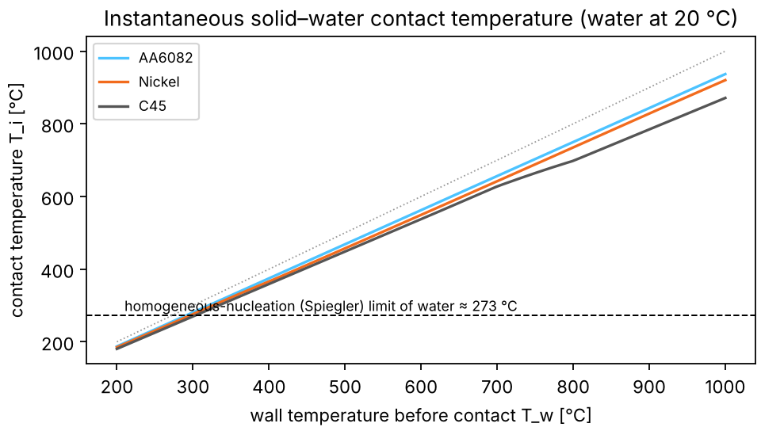

# Transition boiling, the Leidenfrost point and film boiling

## Film boiling

Above the Leidenfrost temperature a continuous **vapour film** separates the liquid from the wall.
Heat crosses the film by conduction (and convection in the vapour), with radiation in parallel, and
evaporates liquid at the outer interface. For laminar film boiling on a large horizontal surface,
Berenson's analysis gives

\[
h_\text{film} = 0.425\left[\frac{k_v^3\,\rho_v\,(\rho_l-\rho_v)\,g\,h'_{fg}}{\mu_v\,\Delta T_\text{sat}\,L_c}\right]^{1/4},
\qquad L_c = \sqrt{\frac{\sigma}{g(\rho_l-\rho_v)}},
\qquad h'_{fg} = h_{fg} + 0.8\,c_{p,v}\Delta T_\text{sat}.
\]

Bromley's earlier analysis for horizontal cylinders has the same structure (coefficient 0.62, length
= diameter). Radiation adds approximately \(h_\text{rad} = \varepsilon\sigma_{SB}(T_w^4-T_\text{sat}^4)/(T_w-T_\text{sat})\),
which matters above about 600 °C. For saturated pool film boiling these give only tens of kW/m².
Under a **subcooled, high-velocity jet** the film is thinner and the subcooled liquid takes heat away, so the measured
film-branch fluxes are 0.2–2 MW/m² (ATE 2026: below 0.2 MW/m² away from the jet).

Structurally, the vapour–liquid interface on a horizontal film is **Rayleigh–Taylor unstable**.
Vapour bubbles are released at the most dangerous wavelength

\[
\lambda_\text{T} = 2\pi\sqrt{3}\,L_c \approx 27\ \text{mm for water at 1 atm}.
\]

This wavelength also underlies Zuber's CHF and Berenson's minimum heat flux.

## Minimum heat flux and the Leidenfrost temperature

The Leidenfrost point is where film boiling collapses: the minimum of the boiling curve
(\(q_\text{min}\), \(T_\text{min}\) or \(T_\text{Leid}\)). Its value is notoriously scattered. Three groups of
explanations are complementary.

### 1. Hydrodynamic (vapour-production) limit

The film can only be sustained if the vapour generated at the interface is enough to keep releasing
Taylor bubbles. Berenson's result for the minimum heat flux:

\[
q_\text{min} = 0.09\,\rho_v h_{fg}\left[\frac{\sigma g(\rho_l-\rho_v)}{(\rho_l+\rho_v)^2}\right]^{1/4}
\approx 19\ \text{kW/m}^2 \text{ for saturated water at 1 atm}.
\]

This explains the existence of a minimum, but not the high \(T_\text{Leid}\) seen in quenching.

### 2. Thermodynamic limit: homogeneous nucleation

When the liquid touches a wall hotter than its **superheat limit**, liquid in contact flashes to vapour
explosively, with no cavities needed, and contact cannot be maintained. From the van der Waals spinodal,
Spiegler et al. estimated \(T_\text{Leid} \approx \tfrac{27}{32}T_c\), about **273 °C for water**. Kinetic
homogeneous-nucleation theory gives about 300–320 °C at atmospheric pressure.

### 3. Contact temperature: the role of the solid

When liquid touches the wall, the interface instantly takes the **contact temperature** of two
semi-infinite bodies:

\[
T_i = \frac{e_w T_w + e_l T_l}{e_w + e_l},\qquad e = \sqrt{k\rho c_p}\ \text{(thermal effusivity)}.
\]

Rewetting requires \(T_i\) to fall below the liquid's superheat limit. A solid with **low effusivity**
(or a thin oxide or paint layer) cools at the surface on contact, so \(T_i\) drops and rewetting occurs
at a *higher* wall temperature. A high-effusivity metal keeps \(T_i\) close to \(T_w\).

<figure class="qf-figure" markdown>

<figcaption>Contact temperature with 20 °C water for the QuenchFlux materials. With metals, <i>Ti</i> stays
close to <i>Tw</i>, so rewetting requires the wall itself to approach the liquid's superheat limit, unless
other effects (below) raise the apparent Leidenfrost temperature.</figcaption>
</figure>

### Why quench Leidenfrost temperatures are so high

Under jets, measured rewetting temperatures (350–650 °C) lie far above the 270–320 °C of the nucleation
limit. Mechanisms that raise the apparent Leidenfrost point:

- **Subcooling.** Subcooled liquid condenses vapour, thins the film and lowers \(T_i\). \(T_\text{Leid}\)
  rises strongly with subcooling.
- **Jet momentum and impact pressure.** These push the liquid through the film and locally raise the saturation
  temperature at the stagnation point.
- **Surface condition.** Roughness peaks, oxide layers and deposits break the film or act as
  low-effusivity insulating layers.
- **Lateral conduction from the wetted region.** Behind a wetting front, the wall just ahead is
  cooled by conduction, so the front can advance into a wall that is nominally above \(T_\text{Leid}\).

This explains the material trend in the ATE 2026 experiments. Nickel (800 °C, lower diffusivity)
rewets 2.5–3 times more slowly than AA6082 (500 °C). The wall ahead of the front must be cooled through a
larger superheat with less conductive help.

## Transition boiling

Between \(T_\text{Leid}\) and \(T_\text{DNB}\) the wall is **partially wetted**. Liquid touches the wall
intermittently, flashes violently and is pushed off again. The time-averaged flux interpolates between
film-boiling and nucleate-boiling values, weighted by the wetted-area fraction. This fraction rises
steeply as the wall cools, which explains the negative slope \(dq/dT_s < 0\).

- Under heat-flux control this branch is **unstable**: a small temperature rise lowers \(q\), which raises the
  temperature further. It is only accessible under temperature control or in transient quenching.
- In a quench, transition boiling happens in a **narrow annulus just behind the wetting front**. Most
  of the quench heat is removed there and in the nucleate zone behind it.

## Reading these regimes in reconstructions

| Feature | Signature in \(q(t)\), \(T_s(t)\) at a point | QuenchFlux quantity |
|---|---|---|
| film boiling | long plateau of low \(q\) while \(T_s\) is high | `regime == FILM` |
| rewetting / Leidenfrost | onset of the steep rise of \(q\) | `T_leid`, `t_wet` |
| transition boiling | \(q\) rising while \(T_s\) falls | `regime == TRANSITION` |
| MHF / DNB | maximum of \(q\) | `q_max`, `T_dnb` |
| nucleate boiling | \(q\) falling with \(T_s\), above \(T_\text{sat}\) | `regime == NUCLEATE` |

See [Regime analysis](regime-analysis.md).
