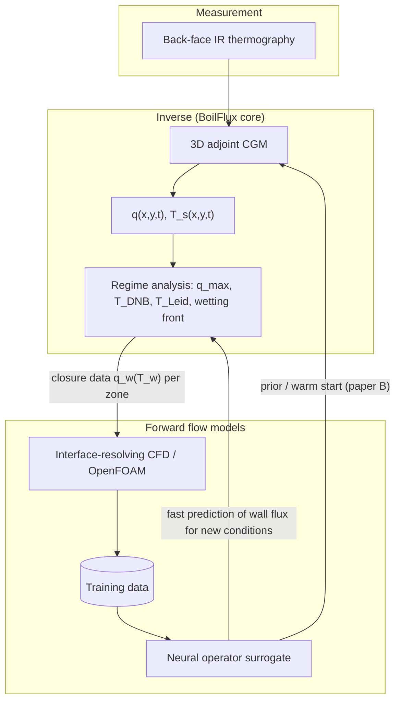

# Modelling boiling flow: CFD, OpenFOAM, PINNs and neural operators

The inverse solution gives the plate-scale heat flux. Explaining it, and predicting it for new
conditions, requires a model of the **two-phase flow**: the liquid film, vapour, bubbles and the
wetting front. This page maps the modelling options and shows how they connect to BoilFlux.

## 1. Interface-resolving CFD (DNS-like)

The liquid–vapour interface is tracked explicitly and the conservation equations are solved in both
phases with jump conditions at the interface:

\[
\nabla\cdot\mathbf u = \dot m\left(\frac{1}{\rho_v}-\frac{1}{\rho_l}\right)\delta_\Gamma,\qquad
\dot m = \frac{\llbracket k\nabla T\rrbracket\cdot\mathbf n}{h_{fg}},\qquad
T_\Gamma = T_\text{sat}(p).
\]

| Interface method | Strengths | Weaknesses |
|---|---|---|
| **Volume of fluid (VOF)** | mass-conserving; the workhorse of OpenFOAM `interFoam`-family solvers | interface curvature is noisy, which causes spurious currents |
| **Level set** | sharp interface and accurate normals and curvature | mass loss without correction; often combined with VOF (CLSVOF) |
| **Phase field** | thermodynamically consistent; handles contact lines | thin diffuse interface, so very fine meshes are needed |
| **Front tracking** | very accurate interfaces | topology changes (coalescence, break-up) are hard |

**Phase-change closures** compute \(\dot m\) from the interface heat-flux jump, or relax the interface
temperature towards \(T_\text{sat}\): Lee (1980) relaxation, Tanasawa/Schrage kinetic models,
Hardt–Wondra (2008) smeared source, and Sato–Ničeno (2013) sharp-interface schemes. Results are
sensitive to the choice and to the relaxation constant, so validation is essential.

**Sub-grid wall physics** is usually what limits accuracy: microlayer evaporation, contact-line
evaporation and contact-angle hysteresis cannot be resolved at engineering mesh sizes and need
sub-grid models.

The **BubbleML** datasets were generated with the Flash-X level-set solver in this category: 2D
interface-resolved pool and flow boiling with conjugate heater conditions. They are the training data
of the [neural-operator prototype](neural-operators.md).

### OpenFOAM routes

- **VOF with phase change.** `interThermalPhaseChangeFoam` (Nabil and Rattner, SoftwareX 2016) adds
  run-time-selectable phase-change and surface-tension models to the VOF framework.
- **Conjugate heat transfer.** Multi-region solvers couple the fluid with the solid plate. This is required for
  quenching, where the wall temperature is not prescribed.
- **IHCP in OpenFOAM.** Sequential and adjoint inverse solvers for spray and jet cooling have been
  built on `laplacianFoam` (see [Landscape](../landscape.md)).

## 2. Eulerian two-fluid models with wall boiling

For industrial-scale flows, both phases are treated as interpenetrating continua with volume
fractions, and wall boiling is represented by **heat-flux partitioning** (RPI model):
\(q_w = q_\text{conv} + q_\text{quench} + q_\text{evap}\) with closures for nucleation-site density,
departure diameter and frequency. The OpenFOAM Foundation release implements this as the
`wallBoiling` fvModel for its multiphase Euler–Euler solver (the wall patches carry an
`alphatBoilingWallFunction`). Research variants couple it with solid regions for conjugate heat transfer.

These models are calibrated for **subcooled flow boiling below CHF**. Post-CHF, transition and film boiling
and quench fronts need additional regime maps or interfacial-area models. That is exactly the regime
where BoilFlux reconstructions provide **measurement-based closure data**: \(q_w(T_w)\) maps per zone.

## 3. Physics-informed neural networks (PINNs)

A PINN represents the fields as a neural network \(T_\theta(x,y,z,t)\) and minimises PDE residuals
together with data misfit. For **conduction-only inverse problems** this is attractive. Recent work
reconstructs pool-boiling heat flux from IR data with PINNs and physics-informed Kolmogorov–Arnold
networks (PIKANs). For **two-phase flow** the difficulties are well known:

- spectral bias against sharp interfaces and steep wetting fronts
- stiff, multi-scale loss balancing (mass, momentum, energy, interface conditions)
- one costly training per case, so there is no reuse across conditions

In BoilFlux, PINNs are planned as a **baseline** for the conduction inverse problem, compared
against adjoint CGM on BF-Bench, rather than as the flow solver.

## 4. Neural operators

A neural operator learns a map between **function spaces**, for example from the current flow state and
boiling parameters to the next state, or from boiling conditions to the wall heat-flux field. After
training, one evaluation costs milliseconds instead of hours of CFD.

| Architecture | Idea | Use for boiling |
|---|---|---|
| **FNO** (Fourier neural operator) | global convolution as learned filters on low Fourier modes | autoregressive flow/temperature surrogates (BubbleML baselines); priors for the inverse problem (paper B) |
| **DeepONet** | branch net (input function) × trunk net (query coordinates) | parametric maps such as jet conditions → wall-flux field |
| **U-Net / CNN operators** | multi-scale local convolutions | sharp interfaces; often more stable for long rollouts |
| **Transformers** (e.g. Bubbleformer) | attention over space-time tokens | long-horizon forecasting of boiling dynamics |
| **Physics-informed operators** | add PDE-residual or conservation penalties | better extrapolation and data efficiency |

Known challenges are **error accumulation in rollouts** (mitigated by multi-step "pushforward"
training and noise injection), **stochastic nucleation** (no deterministic model can predict exactly when a
bubble nucleates), and **generalisation** to unseen fluids, heater temperatures and geometries.

## How the pieces fit together in BoilFlux

1. **Inverse → physics.** Reconstructions give measured, spatially resolved boiling curves and wetting fronts.
2. **Physics → CFD.** These provide closure and validation data for wall-boiling and rewetting models in OpenFOAM.
3. **CFD → neural operators.** Simulations train fast surrogates of the flow and wall heat flux.
4. **Neural operators → inverse.** Surrogates provide priors and warm starts that make the inverse
   problem faster and better posed. A verifier-gated agent (paper C) decides when to trust them.

The [neural-operator prototype](neural-operators.md) is the first working implementation of step 3.
