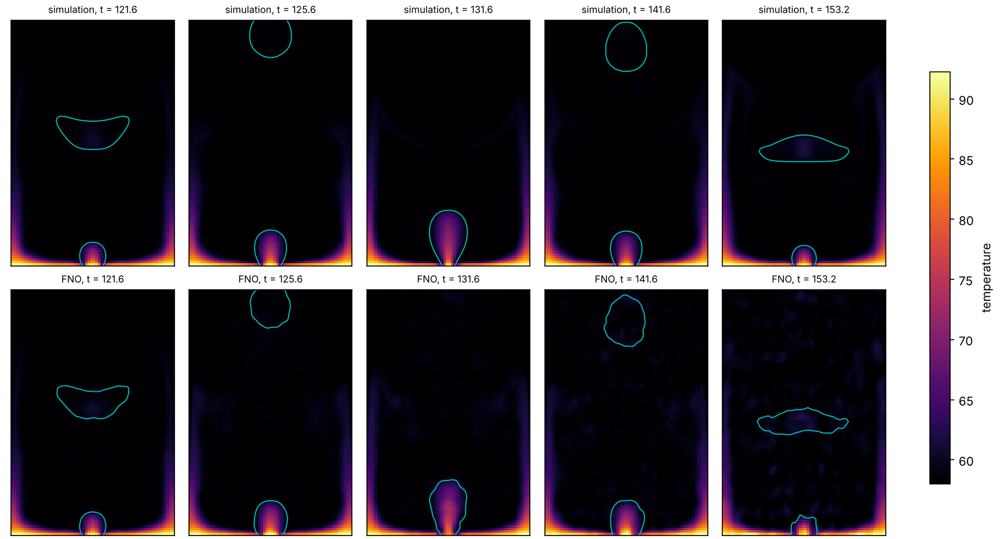
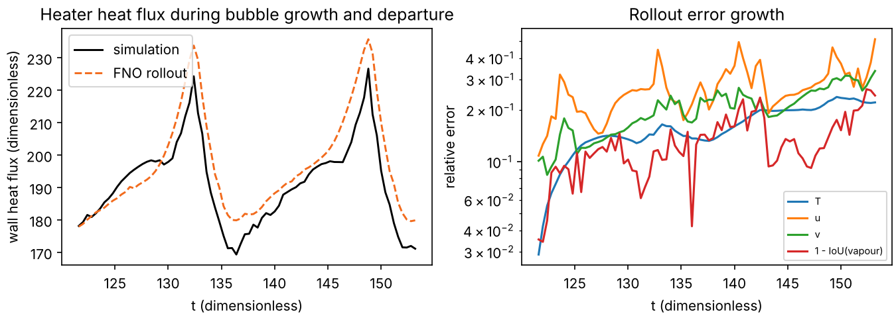

# Neural-operator prototype for boiling flow

This prototype is the first step of the boiling-flow track. A **Fourier neural operator (FNO)** learns the
time evolution of interface-resolved nucleate boiling: temperature, velocity and the liquid–vapour
interface. It then predicts the **heater heat flux** for a heater temperature it has not seen.

## Data

[BubbleML 2.0](https://github.com/HPCForge/BubbleML) single-bubble saturated pool boiling of FC-72
(Flash-X level-set simulations, 2D, conjugate heater wall, nucleation site at the centre).

| | Heater temperatures | Frames used |
|---|---|---|
| training | 87, 91, 96, 103 °C | 300 per simulation (every 2nd output, t = 120–240) |
| test (held out) | **94 °C** | rollout of 80 steps (32 time units) |

Fields are block-averaged from 288 × 192 to 96 × 64 cells. `quenchflux.operators.bubbleml` reads only the
requested frames directly from Hugging Face with HTTP range requests (about 20 MB per simulation
instead of 3.5 GB).

!!! warning "Licence of the data"
    BubbleML 2.0 is distributed under **CC BY-NC-SA 4.0**. The data, and models trained on them,
    are for non-commercial research only. QuenchFlux redistributes neither. It ships only the code that
    downloads the data and trains the model.

## Model

\[
\mathbf s^{n+1} = \mathbf s^{n} + \mathcal G_\theta\big(\mathbf s^{n-3},\dots,\mathbf s^{n};\ T_\text{wall}\big),
\qquad \mathbf s = (T,\ u,\ v,\ \phi),
\]

where \(\phi\) is the level set (positive in vapour, clipped to ±1 around the interface).
\(\mathcal G_\theta\) is an FNO with 4 Fourier layers, width 32 and 12 × 12 retained modes, about 1.19 M
parameters. Two input channels carry the coordinates and one carries the normalised heater temperature.
Training uses AdamW with a one-cycle schedule for 25 epochs, a **two-step unrolled (pushforward) loss**
to reduce error accumulation, and double weight on the interface channel. Training took 21 minutes on 2 CPU cores.

## Results on the held-out heater temperature (94 °C)

<figure class="qf-figure" markdown>

<figcaption>Temperature (colour) and liquid–vapour interface (cyan) from the simulation (top) and the
autoregressive FNO rollout (bottom) for the unseen heater temperature. The operator reproduces bubble
growth at the nucleation site, necking, departure and the rising detached bubble over two ebullition
cycles.</figcaption>
</figure>

<figure class="qf-figure" markdown>

<figcaption>Left: heater heat flux (dimensionless near-wall gradient) from simulation and rollout. The
peaks at bubble departure, when cold liquid rewets the dry spot ("transient-conduction quenching"), are
predicted at the right time. Right: growth of the relative field errors and of 1 − IoU of the vapour region.</figcaption>
</figure>

| Metric (80-step rollout, unseen 94 °C) | Value |
|---|---:|
| mean relative error of the heater heat flux | **3.6 %** |
| mean IoU of the vapour region | 0.87 |
| relative L² error of T, first 5 steps / all 80 | 0.053 / 0.16 |
| relative L² error of u, v (all) | 0.27 / 0.20 |

Errors are relative to the deviation of each field from its mean, which is a strict measure.

## What this shows, and what it doesn't

- The operator has learned the **mechanism**, not just a curve. The heat-flux peaks come from
  rewetting of the dry patch after departure (the transient-conduction mechanism of
  [nucleate boiling](nucleate-chf.md)), and their timing generalises to a new superheat.
- Errors grow along the rollout and the interface becomes slightly wrinkled, which is typical of
  autoregressive operators. Noise injection, longer unrolls and physics-constrained losses are on the
  [roadmap](../roadmap.md).
- This is **pool nucleate boiling** at a few kelvin of superheat. The quench regime (film and
  transition boiling, rewetting fronts at hundreds of kelvin) needs its own training data. The plan is to generate it with
  OpenFOAM conjugate-heat-transfer simulations of jet quenching and validate it against QuenchFlux
  reconstructions (see [Modelling](modelling.md)).

## Reproduce

```bash
pip install "quenchflux[ml]"
python examples/03_boiling_flow_fno.py --out fno_run --epochs 25
```

```python
from quenchflux.operators.bubbleml import fetch_simulation
from quenchflux.operators.train import TrainConfig, train_surrogate, evaluate_rollout, plot_rollout

files = [fetch_simulation("SingleBubble-Saturated-FC72-2D", T, f"T{T}.npz") for T in (87, 91, 96, 103)]
model, info = train_surrogate(files, TrainConfig(epochs=25))
ev = evaluate_rollout(model, fetch_simulation("SingleBubble-Saturated-FC72-2D", 94, "T94.npz"), steps=80)
plot_rollout(ev, "figures")
```
