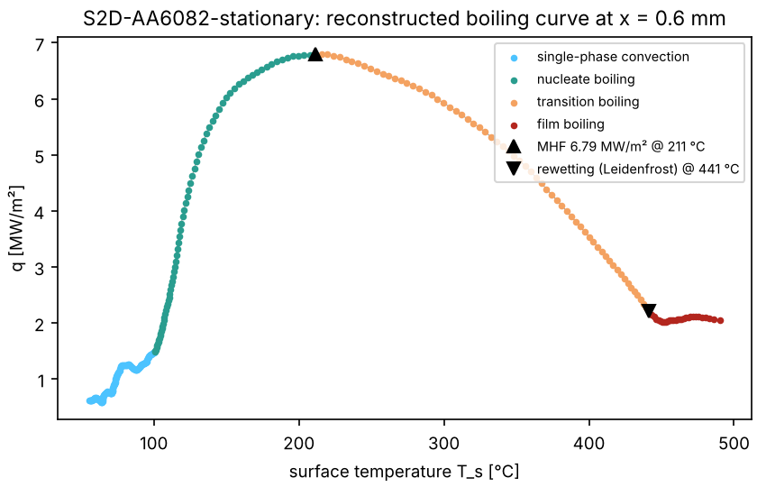
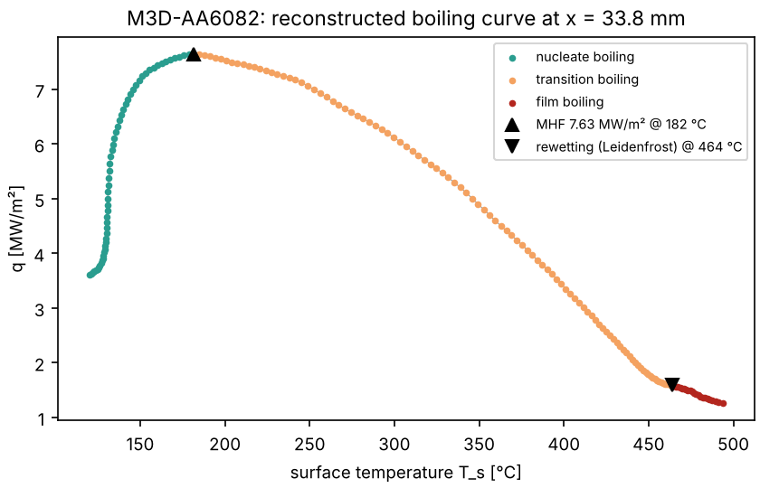
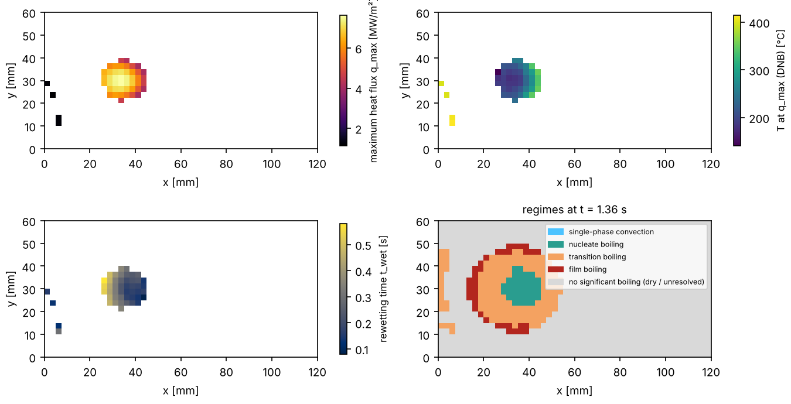

# Regime analysis in BoilFlux

`boilflux.regimes` turns a reconstruction into physical results. At every surface point it
identifies the characteristic points of the local transient boiling curve and the regime sequence.

```python
import boilflux as bf
from boilflux.regimes import (extract_features, feature_maps, wetting_front,
                                plot_boiling_curve_regimes, plot_feature_maps)

res = bf.AdjointCGM(data).solve()
sl = res.reliable                               # drop the end-time window
maps = feature_maps(res.q[sl], res.T_surface[sl], data.t[sl])
maps["q_max"], maps["T_dnb"], maps["T_leid"], maps["t_wet"], maps["regime"]   # (ny, nx) / (nt, ny, nx)
```

## Definitions

| Symbol | Definition used |
|---|---|
| \(q_\text{max}\), \(T_\text{DNB}\), \(t_\text{max}\) | maximum of the smoothed local \(q(t)\) and the surface temperature and time at which it occurs |
| \(q_\text{min}\) | minimum of \(q\) before the maximum (film-boiling branch) |
| \(T_\text{Leid}\), \(t_\text{wet}\) | last instant before \(t_\text{max}\) with \(q \le q_\text{min} + f\,(q_\text{max}-q_\text{min})\), with \(f = 0.05\) by default |
| regime | film for \(t < t_\text{wet}\); transition for \(t_\text{wet} \le t < t_\text{max}\); nucleate after \(t_\text{max}\) while \(T_s > T_\text{sat}\); convection when \(T_s \le T_\text{sat}\) |
| inactive | flux never rises by more than 15 % of the global maximum: no liquid contact or below resolution |
| wetting-front velocity | linear fit of the up- and downstream extent of the rewetted region along a line |

Regimes are assigned by **time** rather than by temperature thresholds. Near a moving jet the surface
temperature is not monotonic, and time ordering stays unambiguous.

## Example: stationary 2D benchmark (`S2D-AA6082-stationary`)

Recovered at the stagnation point: \(q_\text{max}\) = 6.79 MW/m² at \(T_\text{DNB}\) = 211 °C, rewetting at
\(T_\text{Leid}\) = 441 °C. The ground-truth Specht curve has 6.5 MW/m², 200 °C and 450 °C.



## Example: 3D moving plate (`M3D-AA6082`)

Local boiling curve on the jet path, recovered from back-face IR data alone:



Surface maps of the maximum heat flux, the DNB temperature, the rewetting time, and the regime field
1.36 s after the start of quenching:



The regime field shows the structure described in [Quenching](quenching.md): a nucleate core under
the jet, a transition-boiling annulus behind the wetting front, a film-boiling ring ahead of it, and a
dry plate beyond the liquid-covered region.
