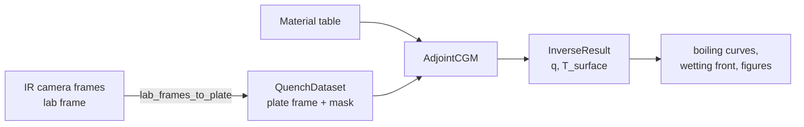

# User guide

QuenchFlux is organised around four objects:

| Object | Role |
|---|---|
| `PlateGrid` | geometry and finite-volume grid of the plate (x = length, y = width, z = thickness) |
| `Material` | temperature-dependent \(k, \rho, c_p\) tables |
| `QuenchDataset` | IR-face temperatures on the plate grid, mask, noise level, kinematics, metadata |
| `AdjointCGM` | the inverse solver, which returns an `InverseResult` |

A typical workflow:

- [Data and IR cameras](data.md): getting your measurements into QuenchFlux
- [Materials](materials.md): built-in and custom property tables
- [Command line](cli.md): `quenchflux info | demo | bench | synth | invert`
- [Python API](api.md): reference of the public classes and functions
